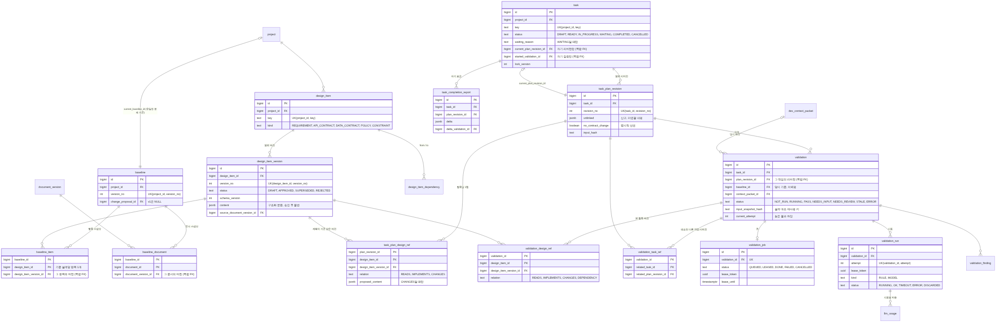
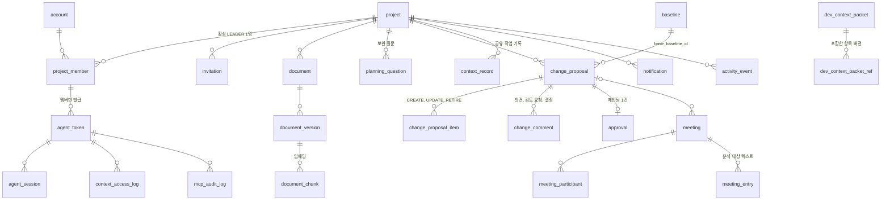
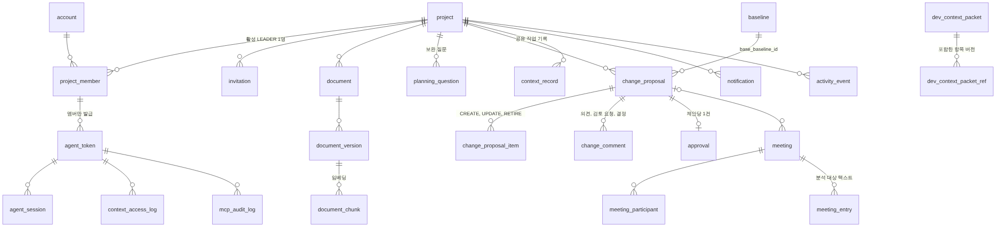

# BEEZ ERD v1.0 (최종본)

> 
>
> 이 설계는 PostgreSQL 16 + pgvector에서 DDL과 불변식 시나리오로 검증했다. DDL은 Flyway 마이그레이션(`backend/src/main/resources/db/migration`)으로 들어간다.

## 0. v0.2 → v1.0 에서 바뀐 것

| 리뷰 지적 | 결정 |
|---|---|
| `baseline_item`에 같은 항목 두 버전이 들어갈 수 있음 | PK `(baseline_id, design_item_id)` + 버전이 그 항목 소속인지 복합 FK + 프로젝트 일치 FK |
| 기준 설계에 문서 버전이 없음 (DOC-08) | `baseline_document` |
| `task_design_link`가 task에만 묶여 계획 수정 전후가 섞임 | **`task_plan_design_ref`로 교체**: 계획 리비전 × 항목 × 버전 × 관계. 현재 점유는 `task.current_plan_revision_id`로 따라간다 |
| 같은 항목에 여러 관계 | **항목당 한 행, 가장 강한 관계 하나** (CHANGES > IMPLEMENTS > READS). 무효화는 세 관계 모두 대상이라 정보 손실이 없다 |
| 검증이 대조한 다른 작업 리비전이 없음 | `validation_task_ref` (관련 작업 + 그 계획 리비전) |
| 검증이 본 설계 버전 | `validation_design_ref` (D4·D5의 기준) |
| 완료 델타가 계획 리비전을 수정 | `task_completion_report` (불변) |
| `design_relation` 다형 FK | **`design_item_dependency`** (항목 ↔ 항목, 실제 FK). 작업 연결은 계획 참조, 문서 연결은 버전의 출처 컬럼 |
| 표시 키 전역 UK | `(project_id, key)` UK |
| 보완 질문·답변 저장 위치 없음 | `planning_question` |
| 회의 원문·참여 상태 없음 | `meeting_participant`, `meeting_entry`. MTG-01~03은 `change_comment` 재사용 |
| 컨텍스트 패킷 보존 (TRC-03) | `dev_context_packet` + `dev_context_packet_ref`. 검증이 패킷을 참조 |
| 워커 실행 소유권 | `validation_job.lease_token`, `validation_run.lease_token`, `validation.current_attempt` (fencing) |
| current 포인터 이중 관리 | **`design_item.current_approved_version_id`, `document.current_approved_version_id` 삭제.** 현재 버전은 `project.current_baseline_id` → `baseline_item` / `baseline_document` 조인으로만 구한다. `task.baseline_id`, `task.latest_validation_id`도 삭제 |
| 단순 FK는 소속을 보장하지 않음 | `(id, parent_id)` 복합 FK로 소유 관계 보장 (아래 4절) |
| 불변성이 문장뿐 | 트리거로 UPDATE 차단 (승인 항목 버전 본문, 기준 설계, 계획 리비전·참조, 검증 참조, 승인, 완료 보고, 패킷) |

## 1. 테이블과 소유자 (42개)

| 묶음 | 테이블 | 소유 |
|---|---|---|
| A. 계정·프로젝트·에이전트 | account, project, project_member, invitation, agent_token, agent_session | 전진 |
| B. 문서·설계·기준 설계 | document, document_version, design_item, design_item_version, baseline, baseline_item, baseline_document, design_item_dependency, planning_question | 오서현 |
| B. 변경·승인·협의 | change_proposal, change_proposal_item, change_comment, approval, meeting, meeting_participant, meeting_entry | 오서현 |
| C. 작업·계획·검증 | task, task_plan_revision, task_plan_design_ref, task_dependency, task_completion_report, validation, validation_design_ref, validation_task_ref, validation_run, validation_job, validation_finding | 변준성 |
| C'. 개발 컨텍스트 | dev_context_packet, dev_context_packet_ref, context_record, document_chunk | 박상은 (MCP-05~07 도구 계약은 전진 주관) |
| C'. 조회 이력·비용 | context_access_log, llm_usage | 변준성 (llm_usage 기록은 각 AI 기능) |
| D. 운영 공통 | notification, activity_event, mcp_audit_log | 전진 |

공통: `id BIGINT GENERATED ALWAYS AS IDENTITY`, `created_at`·`updated_at TIMESTAMPTZ`, enum은 TEXT + CHECK, 구조화 데이터는 JSONB, 물리 삭제 없음. 연결 테이블(`baseline_item`, `baseline_document`, `design_item_dependency`, `task_plan_design_ref`, `task_dependency`, `validation_design_ref`, `validation_task_ref`, `dev_context_packet_ref`, `meeting_participant`)은 복합 PK 예외.

## 2. 핵심 관계 — 설계 · 계획 · 검증

```mermaid
erDiagram
  project ||--o{ design_item : ""
  project |o--|| baseline : "current_baseline_id (유일한 현재 기준)"
  design_item ||--o{ design_item_version : "불변 버전"
  baseline ||--o{ baseline_item : "항목 스냅샷"
  baseline ||--o{ baseline_document : "문서 스냅샷"
  design_item_version ||--o{ baseline_item : ""
  document_version ||--o{ baseline_document : ""
  design_item ||--o{ design_item_dependency : "from / to"

  task ||--o{ task_plan_revision : "불변 리비전"
  task |o--|| task_plan_revision : "current_plan_revision_id"
  task_plan_revision ||--o{ task_plan_design_ref : "항목당 1행"
  design_item_version ||--o{ task_plan_design_ref : "계획이 기준 삼은 버전"
  task ||--o{ task_completion_report : "자기 보고"

  task_plan_revision ||--o{ validation : "입력"
  validation ||--o{ validation_design_ref : "본 항목 버전"
  validation ||--o{ validation_task_ref : "대조한 다른 작업 리비전"
  design_item_version ||--o{ validation_design_ref : ""
  task_plan_revision ||--o{ validation_task_ref : ""
  dev_context_packet |o--o{ validation : "당시 패킷"
  validation ||--o| validation_job : "큐"
  validation ||--o{ validation_run : "시도"
  validation ||--o{ validation_finding : ""
  validation_run ||--o{ llm_usage : "시도별 비용"

  baseline {
    bigint id PK
    bigint project_id FK
    int version_no "UK(project_id, version_no)"
    bigint change_proposal_id FK "v1은 NULL"
  }
  baseline_item {
    bigint baseline_id PK
    bigint design_item_id PK "기준 설계당 항목 1개"
    bigint design_item_version_id FK "그 항목의 버전 (복합 FK)"
  }
  baseline_document {
    bigint baseline_id PK
    bigint document_id PK
    bigint document_version_id FK "그 문서의 버전 (복합 FK)"
  }
  design_item {
    bigint id PK
    bigint project_id FK
    text key "UK(project_id, key)"
    text kind "REQUIREMENT, API_CONTRACT, DATA_CONTRACT, POLICY, CONSTRAINT"
  }
  design_item_version {
    bigint id PK
    bigint design_item_id FK
    int version_no "UK(design_item_id, version_no)"
    text status "DRAFT, APPROVED, SUPERSEDED, REJECTED"
    int schema_version
    jsonb content "구조화 본문, 승인 후 불변"
    bigint source_document_version_id FK
  }
  task {
    bigint id PK
    bigint project_id FK
    text key "UK(project_id, key)"
    text status "DRAFT, READY, IN_PROGRESS, WAITING, COMPLETED, CANCELLED"
    text waiting_reason "WAITING일 때만"
    bigint current_plan_revision_id FK "자기 리비전만 (복합 FK)"
    bigint started_validation_id FK "자기 검증만 (복합 FK)"
    int lock_version
  }
  task_plan_revision {
    bigint id PK
    bigint task_id FK
    int revision_no "UK(task_id, revision_no)"
    jsonb unlinked "신규, 미연결 내용"
    boolean no_contract_change "명시적 선언"
    text input_hash
  }
  task_plan_design_ref {
    bigint plan_revision_id PK
    bigint design_item_id PK
    bigint design_item_version_id FK
    text relation "READS, IMPLEMENTS, CHANGES"
    jsonb proposed_content "CHANGES일 때만"
  }
  validation {
    bigint id PK
    bigint task_id FK
    bigint plan_revision_id FK "그 작업의 리비전 (복합 FK)"
    bigint baseline_id FK "당시 기준, 이력용"
    bigint context_packet_id FK
    text status "NOT_RUN, RUNNING, PASS, NEEDS_INPUT, NEEDS_REVIEW, STALE, ERROR"
    text input_snapshot_hash "설계 대조 재사용 키"
    int current_attempt "늦은 결과 차단"
  }
  validation_design_ref {
    bigint validation_id PK
    bigint design_item_id PK
    bigint design_item_version_id FK
    text relation "READS, IMPLEMENTS, CHANGES, DEPENDENCY"
  }
  validation_task_ref {
    bigint validation_id PK
    bigint related_task_id PK
    bigint related_plan_revision_id FK
  }
  validation_job {
    bigint id PK
    bigint validation_id FK "UK"
    text status "QUEUED, LEASED, DONE, FAILED, CANCELLED"
    uuid lease_token
    timestamptz lease_until
  }
  validation_run {
    bigint id PK
    bigint validation_id FK
    int attempt "UK(validation_id, attempt)"
    uuid lease_token
    text kind "RULE, MODEL"
    text status "RUNNING, OK, TIMEOUT, ERROR, DISCARDED"
  }
  task_completion_report {
    bigint id PK
    bigint task_id FK
    bigint plan_revision_id FK
    jsonb delta
    bigint delta_validation_id FK
  }
```

## 3. 나머지 관계

## 4. 소유 관계를 DB가 보장하는 방식

단순 FK는 "그 id가 존재한다"까지만 확인한다. 아래는 `(id, parent_id)` 유니크 + 복합 FK로 "그 부모의 것"까지 보장한다.

| 참조 | 보장 |
|---|---|
| `project.current_baseline_id` | 같은 프로젝트의 기준 설계 |
| `baseline_item.design_item_version_id` | 그 행의 `design_item_id` 소속 버전, 기준 설계와 같은 프로젝트 |
| `baseline_document.document_version_id` | 그 문서의 버전 |
| `task.current_plan_revision_id`, `task.started_validation_id` | 그 작업의 리비전·검증 |
| `task.assignee_member_id`, `task_dependency` | 같은 프로젝트 |
| `agent_token (project_id, account_id)` | 그 프로젝트의 멤버 |
| `validation.plan_revision_id`, `task_completion_report` | 그 작업의 리비전 |
| `*_ref.design_item_version_id` | 그 행의 항목 소속 버전 |
| `change_proposal.base_baseline_id`, `published_baseline_id` | 같은 프로젝트 |

순환 참조(`project ↔ baseline`, `task ↔ task_plan_revision`, `task ↔ validation`, `baseline ↔ change_proposal`)는 `DEFERRABLE INITIALLY DEFERRED`라 같은 트랜잭션 안에서 순서 없이 넣을 수 있다.

## 5. 불변식과 검증 결과

PostgreSQL 16.15 + pgvector에서 실행한 검증 결과 (2026-10-22).

| 불변식 | 구현 | 결과 |
|---|---|---|
| 기준 설계당 항목 1버전 | PK `(baseline_id, design_item_id)` | 거부됨 ✓ |
| 다른 항목·다른 프로젝트의 버전을 스냅샷에 넣을 수 없음 | 복합 FK | 거부됨 ✓ |
| 승인 버전 본문 불변, 상태는 APPROVED→SUPERSEDED만 | 트리거 | 거부됨 ✓ |
| 표시 키는 프로젝트 내 유니크 | `(project_id, key)` UK | 거부됨 ✓ |
| 활성 팀장 1명 | 부분 유니크 인덱스 | 거부됨 ✓ |
| 비멤버는 토큰 없음 | 복합 FK | 거부됨 ✓ |
| 계획 리비전 불변 | 트리거 | 거부됨 ✓ |
| 다른 작업의 리비전을 current로 지정 불가 | 복합 FK (deferred) | 거부됨 ✓ |
| 자기 자신 선행 불가 | CHECK | 거부됨 ✓ |
| CHANGES면 변경 내용 필수 | CHECK | 거부됨 ✓ |
| 시작 검증 없이 IN_PROGRESS 불가 | CHECK | 거부됨 ✓ |
| 이전 attempt·STALE 이후 늦은 결과 | 조건부 UPDATE | 0행 반영 ✓ |
| 같은 항목 CHANGES 두 작업 동시 START (D4) | `project` 행 FOR UPDATE + 겹침 검사 | A 성공, B는 A 커밋까지 대기 후 거부 ✓ |
| 같은 START 재요청 | 멱등 처리 | 같은 결과 ✓ |
| 무관한 설계 변경 후 시작 (D4·D5 충돌 해결) | `validation_design_ref` 버전 비교 | 이전 기준 PASS로 시작 성공 ✓ |
| 변경 항목을 CHANGES한 진행 중 작업 | 발행 트랜잭션에서 STALE + WAITING | WAITING(REVALIDATION) ✓ |
| 변경 항목을 READS한 작업 | 같은 경로 | 시작 전이면 시작 거부, 진행 중이면 WAITING ✓ |

`try_start`, `publish_change` 테스트 함수는 서비스 로직을 SQL로 옮긴 **프로토타입**이다. 실제 구현은 Java 서비스에 두고, 이 시나리오를 Testcontainers 통합 테스트로 옮긴다.

## 6. 남은 결정

- 항목 본문 `content` 스키마 (`kind`별, 특히 API 계약) — 오서현·박상은
- 임베딩 차원 N — 지금은 `vector(1024)` 임시값
- `design_item_dependency`를 무효화에서 몇 단계까지 따라갈지 (제안 1단계)
- 계획 참조의 "가장 강한 관계 하나" 규칙에 팀 동의
- 문서 파일 저장소 (MVP 로컬 볼륨)
