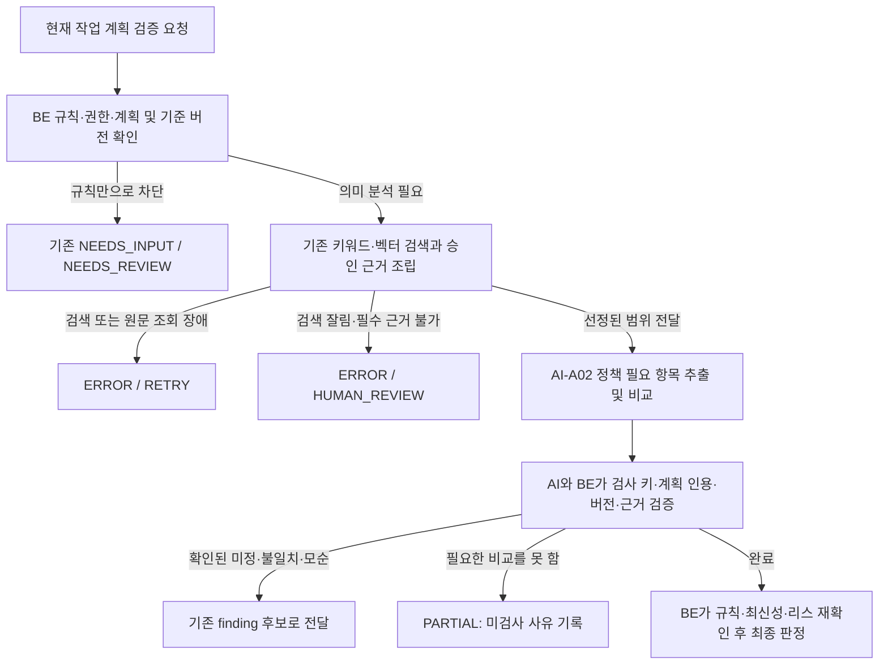

# 작업 계획의 정책 누락·모순·미확정 분석 설계 (S15P31A108-186)

작성일: 2026-11-03. 기준 코드: `dev` `6d663bbdab89e7729221ef89d50a1cf69fc9d763`. 이 문서는 구현 전 제안이며 새 API나 판정 규칙이 이미 배포됐다는 뜻이 아니다.

> 구현은 이후 최신 `dev` 위의 186 브랜치에서 진행했다. 이 문서는 당시 설계와 결정 근거를 보존한 것이며, 구현된 공개 정책 분석 필드·화면 및 실모델 검증 결과는 [평가 기록](../../ai/evaluations/policy_gap/README.md)을 참고한다. 기본 feature flag는 꺼져 있다.

## 목표와 범위

[186번](https://ssafy.atlassian.net/browse/S15P31A108-186)은 작업 계획을 수행할 때 확인해야 할 정책을 찾고, 현재 승인 설계와 대조해 정책 미정·계획과의 불일치·정책 간 모순을 **검토 후보**로 제공한다. 검색 장애, 확인 범위 부족과 실제로 모순된 근거를 구별한다. 모델의 추론은 프로젝트 정책을 확정하거나 승인·작업 상태를 변경하지 않는다.

기존 검증 요청 및 응답을 확장한다. 별도 검증 워커·검증 이력·검색 엔진을 만들지 않는다. 후속 행동별 담당자 추천과 협의·변경 경로는 [187번](https://ssafy.atlassian.net/browse/S15P31A108-187)의 범위다. 186에서 정책의 부재·모순을 문서·설계에 자동 반영하지 않는다.

## 현재 코드에서 확인한 것

1. `ValidationWorker`가 159번 큐·리스, `ValidationInputAssembler`의 승인 설계·하이브리드 검색·원문, AI-A02 `POST /v1/validate`, `AnalysisResultApplier`를 연결한다. 최종 판정은 backend가 한다.
2. `ai/app/services/validation.py`와 `AnalysisResultApplier`는 `MISSING_POLICY`에 같은 설계 버전의 인용 근거와 명시적인 `정책: 미정` 형식을 요구한다. 단순 검색 0건으로 정책이 없다고 확정하지 않는다. 미해결 질문은 현재 `PARTIAL`과 사람 검토로 이어질 수 있다.
3. `ValidationRules`는 `READS`만 있고 미연결 내용·관련 작업이 없는 일반 검증을 AI 호출 없이 즉시 `PASS`한다. 이 경로에는 정책 검사가 없으므로 186의 적용 대상과 시작 관문 변경을 별도로 결정해야 한다.
4. AI-A02의 검사는 계획 완결성, 설계 정합성, 관련 작업 충돌이며 `ValidateResult`는 `extra=forbid`다. 현재는 정책 요구사항 목록을 별도 산출하거나 정책 검사 범위를 독립적으로 기록하지 않는다. 찾은 문서·항목이 모두 정책에 해당한다고 간주하면 안 된다.
5. finding은 기본 설계 항목/버전 한 쌍을 갖고, 그 항목을 지정한 finding의 근거는 같은 버전에서만 인용할 수 있다. 서로 다른 승인 정책 두 건의 모순을 양쪽 항목 ID와 근거로 표현하는 전용 계약은 없다. `evidence_ids`는 DB에 남지만 현재 `FindingResponse`에는 노출되지 않는다.
6. 발행 후 무효화는 기존 `validation_design_ref`와 정책 판단에 실제 인용한 버전을 별도로 저장한 `validation_policy_ref`를 기준으로 한다. 인용되지 않은 검색 후보는 이력용이며 확정 참조가 아니다. 실행 중에는 분석 당시 baseline과 현재 baseline이 달라지면 `searchInputsCurrent`가 결과를 폐기한다. 따라서 **완료 후 무관한 변경**과 **분석 도중 변경**의 처리는 다르다.

## 제안 흐름



### 1. 정책 확인 항목 추출과 검색

- 기존 계획의 `goal`, `included_scope`, `approach`, `completion_criteria`, `design_refs`, `unlinked`를 AI-A02 입력으로 사용한다. 필수 정책 항목 목록은 코드에 로그인·결제 같은 고정 단어 목록을 두지 않고, 현재 계획에 근거한 **분석 후보**로 추출한다.
- 각 후보에 계획 필드 경로와 그 필드에 실제로 존재하는 인용을 요구한다. 예를 들어 `로그인 API 구현`에서 `로그인 실패 제한 정책 확인`을 후보로 제시할 수 있지만, 프로젝트에 해당 정책이 있다고 단정하지 않는다. 인용의 존재 검사는 추출된 항목의 **의미적 타당성이나 누락 없음**을 보장하지 않으므로 별도로 평가한다.
- 검색은 기존 `ValidationInputAssembler`의 계획 기반 하이브리드 검색을 재사용한다. 선택된 승인 설계·원문만 모델에 주며, 검색된 청크를 임의의 설계 항목이나 확정 관계에 연결하지 않는다. 검색 결과가 적절한 정책을 빠뜨릴 수 있다는 `coverage=UNKNOWN`을 유지한다.
- 이번 제안은 기존 한 번의 AI 호출 안에서 항목 추출과 비교를 수행한다. 추출한 항목을 다시 검색하는 2단계 검색은 구현하지 않으므로, 계획의 표현과 검색 후보가 어긋나면 관련 정책이 검색되지 않을 수 있다. 그때 해당 검사는 근거 부족으로 남긴다. 필요하면 실제 평가 결과에 따라 후속으로 2단계 검색을 검토한다.
- 제안 한도: 정책 필요 항목 최대 20개. 초과하거나 계획 인용을 복원할 수 없으면 잘라서 완료 처리하지 않고 `PARTIAL / EVIDENCE_INSUFFICIENT`로 남긴다. 한도는 기존 요청 200KB 및 시간 예산과 함께 시험 후 확정한다.

### 2. 검사 및 결과 계약 제안

AI-A02 요청의 `checks`에 `policy-gap-v1` 검사와 `POLICY_ALIGNMENT` 종류를 추가한다. backend가 검색 후 정한 승인 설계 버전 목록을 검사 범위로 넣고, AI가 검사 키·설계 ID를 만들어 추가하지 못하게 한다. `plan-completeness` 및 기존 설계/작업 검사는 유지한다. 새 종류는 현재 코드에 없으므로 AI 스키마·프롬프트와 BE 요청 조립기·출력 검증기를 함께 수정해야 한다.

정책 검사에 한해 `result.policy_assessments`를 추가하는 안이다. `need_id`는 **한 분석 안에서만 유일한 임시 ID**이며 정책 ID나 확정 관계가 아니다.

```json
{
  "analysis_status": "PARTIAL",
  "checked_keys": ["plan-completeness"],
  "unassessed": [{"check_key": "policy-gap-v1", "reason": "EVIDENCE_INSUFFICIENT", "message": "로그인 실패 제한의 승인 정책을 확인하지 못했습니다."}],
  "findings": [],
  "policy_assessments": [{
    "need_id": "need-1",
    "topic": "로그인 실패 제한",
    "plan_evidence": {"field": "goal", "index": null, "quote": "로그인 기능을 구현한다"},
    "state": "INSUFFICIENT",
    "design_item_version_ids": [],
    "approved_content_refs": [],
    "evidence_ids": [],
    "explanation": "관련 승인 정책 근거를 확인하지 못했습니다."
  }]
}
```

`policy_assessments`의 상태는 기존 공개 Validation 상태를 대체하지 않는다.

| 상태 제안 | 판단과 근거 | 기존 계약에 연결 |
| --- | --- | --- |
| `SUPPORTED` | 선택된 승인 항목의 실제 내용에서 해당 계획과 관련된 정책을 확인할 근거가 있음 | 검사 결과에 근거와 범위 기록. 이것만으로 최종 PASS나 전체 정책 완전성을 보장하지 않음 |
| `EXPLICITLY_UNDECIDED` | 같은 승인 설계에 연결된 확인 가능한 원문에 정책 미정이 명시됨 | 기존 검증 조건을 통과한 경우에만 `MISSING_POLICY / BLOCKING` → BE `NEEDS_REVIEW` |
| `CONTRADICTORY` | 같은 대상·조건·기간의 승인 근거끼리 실제로 상충하거나, 계획 내용이 승인 정책과 구체적으로 다름 | 승인 항목 두 건의 모순은 `CONFLICT`, 계획과 승인 정책 불일치는 `MISMATCH`. 차단 여부는 근거와 기존 판정 규칙에 따른다 |
| `INSUFFICIENT` | 필요한 정책·적용 범위·원문을 판단할 근거가 없음. 검색 0건도 여기에 속함 | `policy-gap-v1`을 `unassessed`로 두고 `PARTIAL` → BE `ERROR / HUMAN_REVIEW` |

AI와 BE는 정책 검사가 요청됐을 때에만 이 배열을 요구하고, `need_id`의 유일성·개수, 허용된 계획 필드/배열 인덱스와 정확한 인용, 상태별 필수 근거를 검사한다. 승인 항목에 연결된 원문이 없더라도 `SUPPORTED` 근거로 `approved_content_refs`에 설계 버전, 구조화된 내용의 경로와 실제 값을 가리킬 수 있다. 서버는 버전이 해당 check에 있고 경로·값이 요청한 승인 내용에 정확히 존재하는지 확인한다. 이때 문서 출처가 있다고 만들지 않는다. 하나라도 `INSUFFICIENT`이면 정책 검사는 `unassessed`다. 전부 판단 가능할 때에만 정책 검사를 `checked_keys`로 두며, 미정·모순 상태는 검증된 `MISSING_POLICY` 또는 `MISMATCH`/`CONFLICT` finding과 서로 대응해야 한다. 정책 finding의 선택 필드 `policy_need_id`로 해당 실행의 `need_id`를 연결하고, 존재하지 않는 ID와 동일한 근거의 중복 finding을 거부한다. 입력에 없는 항목이나 원문, 근거 없는 확정 상태, 서로 모순되는 상태·finding은 출력 계약 위반으로 처리한다.

검색 실패·모델 실패·timeout·출력 계약 위반은 `INSUFFICIENT`라는 모델 결과로 바꾸지 않는다. 기존 `ERROR / RETRY` 경로를 사용한다. `MISSING_POLICY`는 현행 코드에서 **명시적 미정 원문**만 허용하므로, 더 넓은 정책 부재 판정은 승인된 전체 정책 목록과 완전성 범위가 정해지기 전까지 추가하지 않는다. `next_action`의 “설계에 없는 정책” 문구도 명시적 미정에 맞게 고친다.

정책 필요 항목이 없다고 반환할 때도 `no_policy_requirements_reason`과 실제 계획 인용을 남긴다. 계획이 모호해 관련성을 판단할 수 없으면 빈 목록을 완료로 바꾸지 않고 미검사로 둔다. 이 분류는 의미 판단이므로 별도 평가 없이는 빈 결과를 자동으로 완전한 정책 목록이라고 주장할 수 없다.

한 검사가 `unassessed`면 그 검사에는 정상 finding을 붙일 수 없다. 한 정책은 확실히 모순되지만 다른 정책은 근거가 부족한 경우 전체 결과는 현행 규약대로 PARTIAL이다. `COMPLETE`에는 검증된 `policy_assessments`와 분석 버전을 해당 실행의 요약에 남기고, `PARTIAL`에는 검증된 부분 후보를 진단에 보존하도록 `diagnostics()`도 확장하되 정상 finding으로 반영하지 않는다. 양쪽 모두 기존 크기 한도와 권한 범위를 적용한다. 사용자가 두 정보를 동시에 확인하는 공개 계약은 별도 합의가 필요하다. 현재 DTO가 진단 전체를 표시한다고 가정하지 않는다.

### 3. 승인 정책 두 건의 모순

계획과 정책의 비교는 기존 단일 `design_item_id`/버전으로 표현한다. 두 승인 정책이 모순되는 경우에는 다음의 **계약 확장 제안**이 필요하다.

- `policy-gap-v1`의 `design_item_version_ids`에 비교 대상들을 넣는다. `CONFLICT` finding은 대표 항목 한 쌍과 추가 `conflicting_design_refs[]`를 가지며, 배열 원소는 `design_item_id`, `design_item_version_id`, 해당 `evidence_ids`와 구조화 내용의 `content_paths`를 가진다. 각 측은 검증된 원문 또는 구조화 승인 내용으로 뒷받침해야 한다. 양쪽을 식별하지 못하면 확정 충돌 대신 `INSUFFICIENT`다.
- 각 항목과 버전이 같은 프로젝트·해당 baseline·해당 check의 승인 입력에 있는지, 인용한 각 source/evidence가 **그 항목의** 입력 내용과 일치하는지 AI와 BE가 각각 검증한다. 텍스트뿐인 검색 문서는 임의의 설계 ID를 얻지 않는다. 서로 다른 조건·대상·기간이면 충돌로 확정하지 않는다.
- 현재 단일 항목 인용 제한을 `POLICY_ALIGNMENT`의 검증된 다중 근거에 한해 확장한다. 기존 검사에는 지금의 한 항목 범위를 그대로 적용한다. 기존 `sources` 목록과 추가 설계 참조를 함께 보존한다.
- `validation_finding`에 선택적 `policy_need_id`와 다중 설계 참조 JSONB를 저장하는 마이그레이션, `FindingResponse`의 선택 필드가 필요하다. 생성 시 서버가 모든 ID를 재검사하고 프로젝트 범위 조회만 허용한다. 근거를 나중에 다시 볼 때도 각 승인 항목 버전이나 문서 버전·위치로 복원할 수 있어야 하며, 의미 없는 임시 evidence ID만 화면에 전달하지 않는다. 마이그레이션 번호는 구현 시 최신 dev에서 정한다. FE Zod 스키마와 MCP 응답에서 이 필드가 보존되는지 확인한다. UI 표시 방법은 FE 담당과 합의한다.
- 이 참조는 **모순 후보의 출처**이지 계획의 확정 참조가 아니다. 검증된 정책 판단에서 실제 인용한 버전은 별도의 정책 의존성으로 저장하여 발행 시 확인한다. 하나만 있는 근거를 복제해 양쪽으로 보이게 하지 않는다.

예를 들어 같은 로그인 대상에 정책 버전 `311`은 5회, 버전 `312`는 10회를 명시했다면 대표 항목 `311`과 `conflicting_design_refs=[{"design_item_id":"302","design_item_version_id":"312","evidence_ids":["policy-source-312"],"content_paths":[]}]`를 반환한다. `sources`와 `evidence_ids`는 양쪽의 실제 입력에서 복원한다. AI가 새 출처나 ID를 생성하는 것이 아니다.

## 최신성·재분석 (AC-07)

| 상황 | 이번 설계의 동작 |
| --- | --- |
| 완료된 검증 이후 무관한 문서만 발행 | 기존 163 발행 경로를 유지한다. 직접 참조하거나 정책 판단에 인용한 설계 버전이 바뀌지 않으면 그 이유만으로 STALE·재분석하지 않는다. 문서 전용 발행에 변경 설계 항목이 없으면 `PublicationImpactAdapter`는 빈 영향을 반환한다. |
| 직접 참조한 설계 버전 변경·폐기 | 기존 `validation_design_ref` 기준으로 STALE 및 필요한 작업의 재검증 처리를 유지한다. |
| 검색으로만 찾은 정책 후보가 변경 | 승인 내용이나 원문 근거로 실제 인용한 버전이면 검증을 STALE로 만들고, 그 검증으로 진행 중인 작업은 재검증을 기다린다. 시작·재개도 현재 버전과 대조한다. 단순 검색 후보나 판단 범위에만 있고 인용되지 않은 버전은 무효화하지 않는다. 새로 추가되었거나 인용되지 않은 정책과의 의미적 연관성은 보장하지 않는다. |
| AI가 실행되는 중 어떤 발행으로 baseline이 바뀜 | 현재는 무관한 변경이라도 결과 반영 시 baseline 불일치로 폐기된다. 이 동작을 무관 변경도 재사용한다고 설명하지 않는다. 신규 후보가 생겼을 가능성을 배제할 수 없으므로 기존 안전 검사를 유지한다. |
| 계획·근거·질문·권한·관련 작업·리스 변경 | 기존 반영 직전 재확인과 stale/폐기·권한 처리를 유지한다. 늦은 응답은 결과를 덮어쓰지 못하며 실제 호출 사용량은 보존한다. |

추후 분석 중 무관한 변경까지 재사용하려면 변경 전후 검색 질의·인덱스 준비 상태·후보·인용 버전·원문 해시와 질문을 비교하는 별도 기준이 필요하다. 선택된 검색 결과가 같아도 프로젝트 전체 검색 재현율을 증명하지는 못한다. 단순히 baseline ID만 같지 않다고 비교를 생략하거나 검색 후보를 확정 참조로 저장하지 않는다.

## 도입과 호환성

- 새 정책 검사는 feature flag로 점진 도입한다. AI 서버가 기존 요청을 계속 받도록 먼저 배포한 뒤, BE의 새 응답 검증·저장 및 선택 필드를 배포하고 정책 검사 요청을 켠다. 이전 check만 요청한 경우 새 결과 필드를 생략하는 등 기존 계약을 유지한다. 구버전 AI가 새 check를 거부하면 기존 오류 경로로 처리하며 정책 검사 없이 성공으로 재시도하지 않는다.
- flag를 켠 신규 검증은 직접 참조가 `READS`뿐인 경우에도 정책 검사를 접수하는 방안을 제안한다. 규칙으로 이미 차단된 경우는 기존과 같이 모델을 호출하지 않는다. 호출량·지연·시작 관문 변경이므로 변준성 님과 합의하고 활성화 전 회귀·부하를 확인한다.
- `rules-v2`와 정책 검사 적용 버전을 구분하고, 접수된 실행에 검사 버전을 고정한다. 배포 중 이미 대기하던 실행을 새 규칙으로 조용히 재해석하지 않는다. 과거 PASS를 일괄 무효화하지 않으며 과거 기록은 정책 검사를 했다고 표시하지 않는다. 과거 PASS의 시작 허용 변경은 별도 결정이다.
- 모델은 기존 `TASK_VALIDATION` 호출·usage·예산을 사용한다. [검증 워커 설정](../infra/env.md)의 예산·읽기 제한·리스에 검색 시간까지 포함한 여유가 있는지 확인한다. 새 검사로 한도를 넘으면 실패나 미검사로 남기고 결과를 자르거나 추가 호출을 숨기지 않는다.

## 대표 사례와 완료 확인

아래는 **실행 결과가 아닌 기대 기준**이다. 모델 출력의 의미 검토와 API·DB의 확정 판정은 따로 기록한다.

| 사례 | 기대 |
| --- | --- |
| 계획과 승인 정책이 일치 | 해당 계획 인용과 승인 항목 버전이 연결된다. 전체 검증의 다른 규칙까지 확인한 뒤 BE가 판정한다. |
| 승인 정책 `로그인 실패 5회 후 잠금`, 계획은 10회 | 같은 범위라는 근거를 가진 `MISMATCH`; BLOCKING이면 NEEDS_REVIEW. |
| 승인 원문 `잠금 정책: 미정` | 해당 항목·원문 발췌를 인용한 `MISSING_POLICY/BLOCKING`; NEEDS_REVIEW. 형식이 다르거나 관련 항목과 연결되지 않으면 현재 판정 규칙을 우회하지 않는다. |
| 검색 0건·관련 정책 미발견 | `INSUFFICIENT`, PARTIAL/HUMAN_REVIEW. 정책이 존재하지 않는다고 단정하지 않는다. |
| 승인 정책 두 건이 같은 사용자·조건에 대해 5회와 10회로 충돌 | 두 버전과 각각의 근거를 포함한 `CONFLICT`. 각각 다른 사용자·기간을 다루면 충돌로 단정하지 않는다. |
| 문서 색인 미완료·검색 실패·모델 timeout | 미정 정책과 구분되는 ERROR/RETRY. 호출되지 않은 모델의 사용량을 만들지 않는다. |
| 결과 수·원문·계획 인용 한도 초과 | 생략을 성공으로 감추지 않고 근거 부족 또는 명시적 입력 오류로 남긴다. |
| 관련 없는 문서 발행, 관련 설계 발행 | 완료된 검증은 각각 기존 유지 / 직접 참조 또는 실제 인용 시 STALE. 분석 도중의 baseline 변경은 현재 구현상 폐기됨도 별도 확인한다. |
| 잘못된 프로젝트·다른 검사 ID·허위 출처·프롬프트 삽입 | 거부하거나 데이터로 취급한다. 없는 정책·담당자·승인 상태를 만들지 않는다. |

검증은 ① AI·BE 단위/계약 테스트, ② 격리 PostgreSQL에서 실제 검증 접수→검색→워커→저장→조회와 버전 변경 경합, ③ 테스트 대역을 명시한 BE–FastAPI HTTP 시험으로 나눈다. ④ 합성 정책 문서·계획을 사용해 실제 GMS 모델과 가능하면 실제 테스트용 임베딩·검색까지 연결하고, 후보별 누락·오탐·인용 정확성·지연·사용량을 기록한다. 우선 12개 이상의 서로 다른 사례를 만들고 그중 절반 이상은 프롬프트 수정에 사용하지 않는 별도 평가군으로 고정한다. 대표 사례는 3회 반복하고 각 호출과 실패를 보존한다. 모델 응답의 의미와 원문은 사람이 검토한다. 실제 GMS 또는 임베딩을 쓰지 못한 시험은 그 범위를 결과에 명시하며, 단위 테스트 통과만으로 모델 품질을 주장하지 않는다.

## 구현 순서와 확인할 결정

1. 기존 184 검증의 정책 사례와 READS-only 경로를 재현해 기준을 고정한다.
2. AI-A02 정책 검사·요구사항 및 다중 근거의 요청/응답 계약과 검증을 추가한다. 이전 요청 호환을 확인한다.
3. BE의 정책 검사 선택, 출처 검증·저장·공개 선택 필드와 오류 매핑을 추가하고 기존 159 워커·판정 경로를 재사용한다.
4. 완료 후 무관/관련 발행, 실행 중 발행, 권한·리스 경합을 격리 DB에서 확인한다. 관련성이 추론된 후보를 확정 참조로 바꾸지 않는다.
5. 테스트 대역과 실모델 평가 결과를 분리해 기록하고 FE/MCP 호환성과 배포 순서를 확인한다.

구현 전에 팀이 확인할 항목은 READS-only 검사 확대와 기존 PASS의 취급(변준성), 검색된 정책·원문의 범위와 필요 항목을 이용한 추가 검색 여부(박상은), 다중 근거와 PARTIAL 진단의 화면 표현(박민용)이다. 이 항목은 현재 계약의 변경 제안이며 합의 전 사실로 간주하지 않는다.
