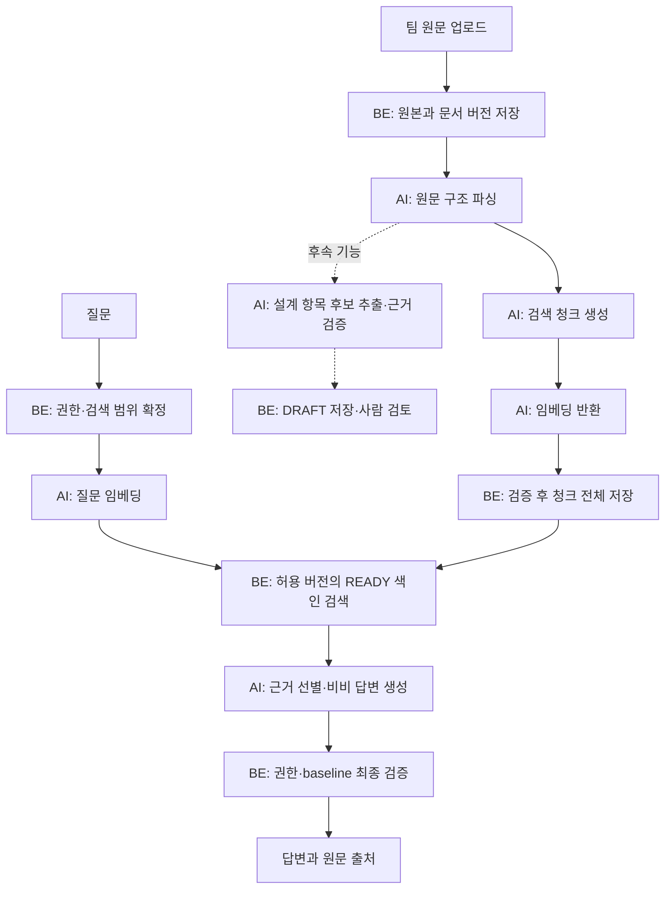

# BEEZ 원문 기반 RAG 개발 계획

> **For agentic workers:** REQUIRED SUB-SKILL: Use superpowers:executing-plans to implement this plan task-by-task. Steps use checkbox (`- [ ]`) syntax for tracking.

**Goal:** 팀이 올린 원문을 버전·위치가 보존된 청크로 색인하고, 비비가 권한과 승인 범위 안의 근거로 답하도록 한다.

**Architecture:** Spring Boot가 업로드·원본 버전·작업 실행·벡터 저장/검색·승인 검증을 담당한다. FastAPI는 Markdown 원문 구조 파싱·청킹·임베딩·컨텍스트 구성·답변 생성을 담당한다. 다음 입력 형식은 OpenAPI JSON이며, 설계 항목 자동 추출은 이 입력 확장과 별개의 후속 기능이다.

**Tech Stack:** 기존 Python 3.12/FastAPI/Pydantic/HTTPX/pytest/ruff, Java 21/Spring Boot, PostgreSQL 17/pgvector. 형식 파서는 기존 #88 설계의 후보를 사용하고 설치 시 호환 버전을 검증·고정한다. 임베딩 모델·차원은 미확정이다.

**Spec:** [#88 상세 설계](../specs/2026-10-24-document-parsing-design.md), [팀 아키텍처](../../design/01-system-architecture.md), [AI 내부 API](../../api/03-ai-internal.md), [평가 계획](../../experiments/document-parsing-evaluation.md).

작성·범위 갱신: 2026-10-26 · 대상: 박상은 #88/#89, #90/#92 연동 · 상태: 구현 전 계획. 사용자는 Markdown 우선 RAG → OpenAPI JSON 입력 확장 → 별도 설계 항목 자동 추출의 추천 방향을 문서에 반영하도록 요청했다. 아래 API 추가·세부 정책·일정은 구현 추천안이며 BE 합의나 Jira 범위 변경 완료를 뜻하지 않는다. 이 계획으로 공통 API나 DB를 변경하지 않는다.

## 1. 현재 기반과 개발 순서

현재 AI 제품 코드는 health/root 수준이다. `document_chunk`와 pgvector는 있으나 청킹·검색·비비 RAG 구현이 있다는 의미는 아니다. 기존 `/v1/embeddings`는 설계되어 있고, `/v1/bee/chat`에는 `approved_items`만 있으며 **검색한 원문 청크를 받는 필드가 없다**. 청킹 API도 없다.

개발 순서: **Markdown 원문 파싱 → 청킹 → 임베딩 → BE 저장/검색 → 비비 근거 답변·검증**까지가 첫 RAG MVP다. 그 다음에는 OpenAPI JSON을 검색 가능한 입력으로 추가한다. 설계 항목 자동 추출·검토 저장, YAML/DDL 전용 파서, OCR은 첫 MVP에 포함하지 않는다. #88의 기존 티켓에 후보 추출까지 포함되어 있으므로, 이 범위를 팀과 나누기 전 Markdown RAG 성공만으로 티켓 전체를 완료 처리하지 않는다.

| 구분 | 구현 산출물 | 소유 경계 |
| --- | --- | --- |
| #88 원문 구조 | SourceDocument/SourceBlock, 원문 위치, 형식별 파서 | 상은 |
| #89 검색 준비 | RetrievalChunk, 임베딩, 검색 조건·정렬 전략 | 상은. DB 저장·실행은 BE 연동 |
| #89 검색 실행 | 권한/승인 필터, 벡터 SQL, 준비 상태, 교체 트랜잭션 | BE 실행 담당 합의 필요. ERD는 document_chunk 영역을 상은 주관으로 표시 |
| #90 컨텍스트 | 검색 근거 선별·예산 관리, 향후 개발 컨텍스트 JSON에 재사용 | 상은. MCP·패킷 저장 담당과 연동 |
| #92 비비 답변 | 원문 근거 기반 답변, 미확정·출처·사용량 | 상은. 대화 API 담당과 연동 |
| 후속 입력 확장 | OpenAPI JSON → operation·참조를 보존한 검색 청크 | 상은. 설계 후보 생성은 포함하지 않음 |
| 후속 설계 후보 | 항목별 구조화, 근거 검증, 후보 반환 | 상은. 오서현이 저장·검토·승인 연결 |

벡터 저장소는 검색용 파생 데이터다. 원본 파일·문서 버전·사람이 승인한 설계 항목은 기존 관계형 저장 모델에 남는다. **LLM 추출 후보를 원문 대신 임베딩하는 것으로 시작하지 않는다.**



## 2. Global Constraints

- 기존 아키텍처대로 AI는 DB·원본 저장소에 직접 접속하지 않는다. 비비 모델에도 SQL/DB 자격증명을 주지 않는다.
- 모든 `/v1/**` 업무 요청은 내부 인증한다. 사용자 제공 project_id나 버전 목록만으로 권한을 인정하지 않고 BE가 범위를 확정한다.
- 원본 bytes의 `content_hash`와 정규화 UTF-8의 `text_hash`를 구분한다. `utf8-lf-v1`: 맨 앞 BOM 제거, CRLF/CR → LF, trim/NFKC 금지. locator는 1-based 끝 행 포함 또는 JSON Pointer다.
- 첫 입력 한도는 1 MiB/100,000 Unicode 문자를 제안한다. 청킹·모델 컨텍스트 예산은 별도로 관리하며 초과분을 조용히 자르지 않는다. 기존 32,000토큰/후보 500개 한도는 후속 설계 추출용이며 첫 RAG 입력 성공 조건에 적용하지 않는다.
- 원문 구조화·색인 준비와 승인 상태는 별개다. 첫 MVP는 설계 후보 추출을 실행하지 않으며 미도입 기능을 PENDING이나 FAILED로 표시하지 않는다. 후속 추출 도입 시에만 독립 실행 상태를 관리하고 추출 LLM 실패로 완전한 원문 색인을 실패 처리하지 않는다.
- 부분 실패한 청크 집합은 검색에 노출하지 않는다. 부분 실패한 설계 후보 집합도 DRAFT에 적용하지 않는다. 한 경로의 실패를 다른 경로의 성공으로 위장하지 않는다.
- 현재 승인 설계 검색은 BE의 `current_baseline_id → baseline_document/baseline_item`에 속한 버전만 사용한다. `status=APPROVED`만으로 과거 승인본을 허용하지 않는다.
- 모델 출력 인용 ID는 전달한 근거 집합 안에서만 허용한다. 인용 존재 검증은 의미 일치의 증명이 아니며 실제 품질 평가를 별도로 수행한다.
- 기존 Flyway V2 수정 금지. 상태·색인 메타 변경은 BE와 합의한 새 migration으로 한다. 현재 `vector(1024)`는 모델 선택의 근거가 아닌 임시 스키마다.
- 의미 검증 LLM 전수 적용, reranker, 질의 재작성, 새 벡터 DB, 메시지 브로커, 복잡한 에이전트 루프는 첫 구현에 넣지 않는다.

## 3. 먼저 맞출 계약과 추천 기본값

| 논의 | 추천안 | 합의 전 할 수 있는 일 |
| --- | --- | --- |
| 원문 입력 | 첫 MVP는 기획·요구사항·API 명세·데이터 설계 모두 Markdown. 다음 입력 확장은 OpenAPI JSON만; YAML/DDL은 별도 후속 | 문서 종류별 Markdown·예상 위치 fixture와 순수 파서 |
| 청킹 호출 | 신규 `POST /v1/document-chunks` 제안. 원문 구조화와 검색 청킹만 수행; LLM 후보 추출 없이 성공 가능 | 함수·DTO·fake 호출 테스트. 합의 후 라우터 공개 |
| 임베딩 | 기존 `/v1/embeddings` 재사용. 문서·질의가 같은 embedding profile을 사용; 모델이 요구하는 문서/질의 전처리는 프로필에 명시 | fake provider, 개수·차원·순서 검증 |
| 저장·검색 실행 주체 | Spring Boot에 저장/검색 구현. 상은은 청크 계약·검색 전략·인수 fixture 제공. BE 클래스 구현 담당은 별도 확정 | 검색 fixture·기대 결과·필터 계약 |
| 비비 입력 | `/v1/bee/chat`에 검색 근거·scope·baseline snapshot 추가 제안. 기존 `approved_items` 유지 | 순수 컨텍스트 빌더·답변 검증기 |
| 준비 상태 | SOURCE/INDEX의 PENDING/RUNNING/READY/FAILED 분리. EXTRACTION은 첫 MVP 미실행이며 향후 독립 상태 | 내부 결과 타입·실패 테스트. 기존 분석 API와의 상태 매핑은 BE 결정 |
| 승인 변경 | 최종 BE 검증에서 변경 감지 시 이번 답변을 폐기하고 재시도 안내. MVP 자동 재생성 없음 | 버전 경합 시나리오와 mock |
| 새 승인본 미색인 | 승인 검색은 준비 중으로 응답. 과거 baseline fallback 없음 | not-ready 테스트 |

새 endpoint의 origin=PARSER, 제안 오류 `index_not_ready`/`baseline_changed`, 상태/응답 필드 이름은 공통 계약 합의 대상이다. 기존 API의 의미를 몰래 바꾸지 않는다. 합의가 늦어져도 순수 파서·청킹·검증 구현은 진행할 수 있지만 서비스 통합 완료를 선언할 수는 없다.

### 첫 MVP의 입력 양식

| 문서 종류 / kind | 형식 | 작성·청킹 기준 |
| --- | --- | --- |
| 기획안 / PLAN | UTF-8 `.md` | 기능·정책별 제목과 조건·예외를 함께 작성 |
| 요구사항 / REQUIREMENTS | UTF-8 `.md` | 요구사항 ID·내용·조건을 표 또는 목록으로 작성 |
| API 명세 / API_SPEC | UTF-8 `.md` | `## POST /api/auth/login`처럼 엔드포인트 제목 아래 기능·인증·요청·성공 응답·오류를 배치 |
| 데이터 설계 / ERD | UTF-8 `.md` | 테이블별 컬럼·타입·NULL·PK/FK·관계를 텍스트로 명시. ERD 이미지는 참고용 |

API 명세의 요청/응답 표에는 이름·타입·필수 여부·설명을 적고 상태 코드별 발생 조건을 작성한다. JSON 예시는 fenced code block에 넣고 원문으로 보존한다. 예시 JSON을 전체 스키마로 간주하거나 예시에 없는 필수 필드·오류를 추정하지 않는다.

API는 엔드포인트별로 요청·응답·오류를 묶고 다른 엔드포인트와 합치지 않는다. 길어서 나누면 각 조각에 상위 엔드포인트 제목의 block 참조와 원문 위치를 남긴다. 참조 메타데이터 보존은 필수이며 제목을 임베딩/모델 입력에 반복하는 문맥 보강은 별도 flag로 평가한다. 데이터 설계도 테이블·명시 관계의 원문 범위를 유지하며 `*_id` 이름만으로 FK를 만들지 않는다.

`ERD + text/markdown` 조합은 기존 DDL 중심 제안을 바꾸므로 BE kind/media_type 허용 목록에 합의가 필요하다. 이미지·HTML 표 등 기계가 읽지 못한 내용을 조용히 제외하지 않는다. 원문 검색 대상은 텍스트로 완결되어야 하며 미지원 내용은 진단한다.

첫 MVP에도 **청크·출처·답변을 전달하는 JSON**은 사용한다. `.json` 업로드 일반 지원이나 설계 항목 의미 추출 JSON을 뜻하지 않는다. 이후 OpenAPI를 기준 원본으로 채택하면 같은 API의 Markdown과 JSON을 별도로 수작업 갱신하지 않는다. 설명용 Markdown이 필요하면 기준 원본의 버전에 연결해 생성·관리한다.

### 검색 모드는 두 개로 제한

- `APPROVED`: 개발 기준 답변. BE가 현재 baseline과 허용 문서/항목 버전을 결정한다. 초기 구현은 baseline 내 필수 문서 모두가 같은 프로필로 READY일 때 허용하는 단순 정책을 추천한다. 일부 문서만 검색하고 완전한 답변처럼 표시하지 않는다.
- `DOCUMENT_REVIEW`: 특정 업로드 문서 분석. BE가 사용자의 접근 권한과 명시적 버전 목록을 검증한다. 아직 승인본이 없어도 사용 가능하나 답변·출처에 미승인 검토 범위를 표시하고 현재 개발 정책으로 취급하지 않는다. 임의 프로젝트 전체 DRAFT 검색은 하지 않는다.

첫 데모는 `DOCUMENT_REVIEW`, 승인 연동 완료 데모는 `APPROVED`로 한다. 사람 편집한 승인 항목과 원문이 충돌하면 승인 항목을 구조화 계약의 기준으로 제시하고 원문 충돌을 명시한다. 모델이 둘을 섞어 새 정책을 만들게 하지 않는다. 원문 출처 연결만으로 원문 자체가 승인됐다고 간주하지 않는다.

설계 항목 자동 추출을 미뤄도 기존 승인·작업 검증 기능의 `design_item` 요구는 사라지지 않는다. 사람이 입력하거나 기존 항목을 사용하는 경로 및 문서 baseline 발행 조건을 BE와 확인한다. 이 경로가 없으면 첫 데모는 DOCUMENT_REVIEW로 제한하고 APPROVED 완료를 주장하지 않는다. 원문 청크를 승인 항목으로 자동 변환해 우회하지 않는다.

## 4. 데이터 경계와 코드 구성

모든 타입은 새 제안이다. 외부 API DTO와 내부 파서 타입을 분리하여 공유 API 합의가 파서 구현을 막지 않도록 한다.

| 내부 타입 | 핵심 필드·규칙 |
| --- | --- |
| SourceInput | project_id, document_version_id, kind, media_type, content, content_hash, text_hash, normalization_version, parser_profile |
| SourceDocument | 위 식별자·해시, normalized_text, parser_version, blocks, diagnostics. text_hash 재계산 일치 필수 |
| SourceBlock | block_id, block_type, heading_path, locator, 원문 범위 참조. block_id는 버전/해시/프로필/위치로 결정 |
| RetrievalChunk | chunk_key, chunk_no, document_version_id, text, source_spans, context_refs, embedding_text, chunking_profile. text는 원문 조각, embedding_text는 선택적 제목/헤더 보강 포함 |
| EmbeddingProfile | profile_id, provider/model, dimension, tokenizer_version, document/query 전처리 버전. 같은 차원이라도 다른 모델은 혼용 금지 |
| IndexManifest | document_version_id, text_hash, parser_version, chunking_profile, embedding_profile, expected_chunk_keys. BE의 실행 ID/attempt에 연결 |
| RetrievedEvidence | evidence_id, document_version_id, locator, text, text_hash, score, index_profile. BE가 복사한 검색 결과 스냅샷이며 AI가 DB 재조회하지 않음 |
| RetrievalScope | mode, project_id, baseline_id 또는 명시적 document_version_ids. BE가 인증한 값 |
| ContextBundle | scope, 선택한 evidence, approved_items, 실제 input_tokens, 누락/예산 진단 |
| RagAnswer | text, 사용 evidence_ids, unresolved, 실제 usage. 외부 Source는 BE가 신뢰 가능한 버전 메타로 조립 |

원문 근거와 부가 문맥을 구분한다. 청크 번호·DB 청크 ID는 재색인 시 바뀔 수 있으므로 영구 출처는 **document_version_id + locator + 원문 해시**다. 모든 청크를 완성하기 전 READY를 반환하지 않는다.

```text
ai/app/
  core/config.py, core/internal_auth.py        # 기존 설정 확장, 내부 인증 공통화
  schemas/documents.py, schemas/retrieval.py   # 위 내부 타입과 합의된 DTO
  schemas/parse.py, schemas/design_items.py    # 후속: 설계 후보 계약
  routers/document_chunks.py                  # 제안 신규 API, 합의 후 연결
  routers/embeddings.py, routers/bee_chat.py
  routers/parse.py                            # 후속: 설계 후보 API
  services/document_parsing/
    normalization.py, pipeline.py             # 공통 parse_source, 원문 범위 검사
    adapters/markdown.py                       # 첫 MVP
    adapters/openapi.py                        # 다음 입력 확장: JSON
    adapters/postgres_ddl.py                    # 후속: DDL
    extraction.py, evidence.py                 # 후속: 설계 후보 추출과 검증
  services/retrieval/
    chunking.py, embeddings.py, context.py     # 청크/벡터/프롬프트 입력
    answering.py, citations.py                 # 답변 생성, 허용 근거 대조
ai/tests/
  fixtures/parsing/, fixtures/rag/
  test_source_parsing.py, test_chunking.py, test_embeddings.py
  test_rag_context.py, test_rag_answer.py, test_parse_evidence.py
  test_document_pipeline_contract.py
```

LLM 공급자 호출은 공통 클라이언트에 위임한다. 위 구조는 새 SDK 래퍼를 각각 만들라는 뜻이 아니다. provider port와 fake를 먼저 만들고 양지훈/공통 담당자의 인터페이스에 어댑터로 연결한다. 기존 `/health` 동작은 유지한다.

## 5. Review Focus

1. 긴 표 한 행·한글/emoji·중복 문장은 위치와 조건을 잃기 쉽다 → Task 1/2에서 원문 복원과 범위 검사.
2. 임베딩 응답 순서 변경·누락·NaN·동일 차원 다른 모델은 잘못된 검색을 만든다 → Task 3에서 key/profile 대조.
3. 새 색인 일부 성공·늦은 이전 실행은 정상 색인을 덮을 수 있다 → Task 4에서 원자적 반영·attempt 검사.
4. 다른 프로젝트/DRAFT/옛 승인본 및 권한 회수는 검색·생성 중 섞일 수 있다 → Task 4/5에서 검색 전 필터와 최종 검증.
5. 원문 내부 명령·모순된 정책·없는 인용은 그럴듯한 오답을 만든다 → Task 5/6에서 비신뢰 근거 분리·명시적 보류·실제 모델 평가.

## 6. 실행 작업

각 task는 테스트 → 최소 구현 → 검증 → 독립 커밋 순서다. 아래 `pytest`/`ruff` 명령은 `ai/`에서 실행한다. 새 파일은 해당 task에서 필요한 것만 만든다. 예시 토큰값·검색 개수는 초기 실험 설정이며 품질 달성값이 아니다.

### Task 1 — Markdown 원문과 위치를 보존한다 (#88)

**Files:** `schemas/documents.py`, `services/document_parsing/normalization.py`, `pipeline.py`, `adapters/markdown.py`; `tests/test_source_parsing.py`, `fixtures/parsing/`.

**Interfaces:** `parse_source(source: SourceInput) -> SourceDocument`; `resolve_source(document: SourceDocument, locator: SourceLocator) -> str`. SourceLocator는 text_lines 또는 json_pointer의 판별 타입이며 해당 어댑터가 해소한다.

- [ ] fixture: `plan.md`, `requirements.md`, `api-spec.md`, `data-design.md`, BOM/CRLF/emoji 변형, 표·목록·JSON 코드, HTML 표 포함 문서. `test_source_roundtrip`에서 4종 문서의 원문 범위 복원, 동일 입력 ID 재현, `test_hash_mismatch` 거부, `test_unsupported_content` 전체 실패를 먼저 정의한다.
- [ ] `python -m pytest tests/test_source_parsing.py -q` 실행: 미구현으로 실패 확인.
- [ ] markdown-it-py 블록 map으로 locator를 만들고 구조·원문 해시를 검증한다. 셀 문자 offset을 정확히 알 수 없으면 표 행/표 범위를 사용한다. LLM은 호출하지 않는다.
- [ ] 같은 테스트 실행 후 통과 확인. 도입 패키지를 Python 3.12/Windows·Linux CI에서 확인하고 `requirements.txt`에 호환 버전을 고정한다.
- [ ] 커밋: `feat: Markdown 원문 구조와 근거 위치 파싱 (S15P31A108-88)`.

**완료:** 원문으로 되돌아갈 수 있는 블록을 생성하며 지원하지 않는 내용을 숨기지 않는다.

### Task 2 — 검색용 청크를 만든다 (#89)

**Files:** `schemas/retrieval.py`, `services/retrieval/chunking.py`, 합의 후 `routers/document_chunks.py`, `core/internal_auth.py`, `main.py`; `tests/test_chunking.py`, `test_document_pipeline_contract.py`.

**Interfaces:** `build_chunks(document: SourceDocument, profile: ChunkingProfile, token_counter: TokenCounter) -> ChunkBatch`. ChunkBatch는 chunks와 IndexManifest의 파싱/청킹 부분을 반환한다. `TokenCounter.count(text: str) -> int`는 실제 임베딩 tokenizer와 맞춘다.

- [ ] `test_chunk_coverage`: 내용 범위 누락 0, 동일 입력 chunk_key 동일, 공백 등 제외 범위 명시. `test_large_table_row`: 초과 행을 하위 범위로 분할하고 원문에 연결. `test_context_not_evidence`: 반복 헤더를 별도 원문처럼 조작하지 않음. `test_api_endpoint_boundary`: 같은 URL의 GET/POST도 혼합하지 않으며 요청·오류·JSON 예시의 분할 조각이 해당 엔드포인트 제목을 참조. `test_data_table_boundary`: 테이블별 컬럼과 명시 FK 설명의 참조 유지.
- [ ] `python -m pytest tests/test_chunking.py -q` 실패 확인.
- [ ] 초기 프로필 제안: 청크 최대 600토큰, 자동 겹침 0, 제목/표 헤더 보강은 flag로 선택하고 기본은 off. 구조 경계로 묶되 초과 블록은 source span을 보존해 분할한다. 보강 토큰도 600 한도에 포함하며 모델 한도가 더 작으면 사전 거부한다. 블록 집합만이 아니라 분할된 원문 범위의 coverage를 검사한다.
- [ ] 합의된 경우에만 `/v1/document-chunks`에 연결한다. 내부 토큰 누락/오류 401, hash/profile 불일치, 원문 실패 시 chunks 없음의 계약 테스트를 추가한다. 입력은 SourceInput + chunking profile + request_key, 결과는 완전한 ChunkBatch와 origin=PARSER/usage=[] 제안이다.
- [ ] `python -m pytest tests/test_chunking.py tests/test_document_pipeline_contract.py -q` 통과 후 커밋: `feat: 원문 위치를 보존하는 검색 청킹 (S15P31A108-89)`.

**완료:** LLM 추출 API와 독립적으로 임베딩 가능한 청크를 얻는다. 추출용 약 4,000토큰 작업 묶음을 검색 청크로 재사용하지 않는다.

### Task 3 — 문서·질의 임베딩 계약을 연결한다 (#89)

**Files:** `services/retrieval/embeddings.py`, `routers/embeddings.py`, `core/config.py`, `main.py`; `tests/test_embeddings.py`.

**Interfaces:** `embed_texts(texts: list[EmbeddingText], profile: EmbeddingProfile, request_key: str, provider: EmbeddingProvider) -> EmbeddingResult`; async 공급자 port는 `embed(texts, profile, request_key)`이고 vectors·profile·실제 usage를 반환한다. public endpoint는 기존 AI-A04를 따른다; 필요한 purpose/profile 메타 확장은 합의 후 반영한다.

- [ ] fake provider로 `test_reordered_vectors_map_by_key`, `test_missing_duplicate_key`, `test_wrong_dimension_nonfinite`, `test_profile_mismatch`, `test_failed_call_usage` 작성. NaN/무한값/0 norm 벡터는 cosine 검색용으로 거부한다.
- [ ] `python -m pytest tests/test_embeddings.py -q` 실패 확인 후 공통 provider adapter를 구현한다. 반환 배열 순서를 그대로 zip하지 않고 key로 매핑한다. 배치 수·재시도·timeout을 설정으로 제한하고 실패 usage를 보존한다.
- [ ] 모델·dimension·전처리 프로필을 BE와 고정한다. 문서와 질문을 동일 프로필의 해당 purpose로 처리한다. 모델 변경은 기존 색인의 재사용이 아닌 재색인 요구로 처리한다.
- [ ] 테스트 통과 후 실제 공급자로 소수 fixture smoke test를 별도 실행하여 모델명·차원·비용을 기록한다. mock 통과를 실제 모델 품질 검증으로 보고하지 않는다.
- [ ] 커밋: `feat: 문서와 질의 임베딩 계약 구현 (S15P31A108-89)`.

**완료:** BE가 검증 가능한 완전한 key→vector 결과를 얻으며 임베딩 실패를 READY로 바꾸지 않는다.

### Task 4 — BE 저장·범위 제한 검색을 통합한다 (#89, 공동 작업)

**Files:** AI `tests/fixtures/rag/`, `tests/test_document_pipeline_contract.py`; 합의 후 `docs/api/00-common.md`, `03-ai-internal.md`. BE 클래스·신규 migration 파일은 실행 담당자가 실제 패키지와 migration 순서를 확인해 정하며 이 계획이 임의 발급하지 않는다.

**Interfaces:** 공동 계약 `publish_index(run_id, attempt, manifest, chunks, vectors)` / `search_evidence(scope, query_vector, embedding_profile, limit) -> EvidenceSnapshot`. 언어별 이름은 BE 담당이 정하고, 입력 의미·검증 규칙은 아래로 고정한다. EvidenceSnapshot은 scope, index profile, 복사한 근거 목록, 준비 상태를 담는다.

- [ ] 작은 두 프로젝트, 문서 v1=10MB/v2=30MB, DRAFT v3=50MB, 같은 문장·다른 권한 fixture를 만든다. AI 계약 fake로 필터 입력을 확인하고, BE에서 동일 데이터의 PostgreSQL 통합 테스트를 먼저 실패시킨다.
- [ ] BE가 원문 버전/run/attempt/hash/profile/key 집합/벡터 차원을 확인한 뒤 한 번에 저장하도록 연결한다. 현재 UNIQUE(version, chunk_no)에는 여러 세대를 동시에 쓸 수 없다. MVP 제안은 run 산출물을 비공개로 준비한 뒤 **한 트랜잭션에서 해당 버전 청크 전량 교체 + READY manifest 교체**다. 실시간 행별 upsert 노출 금지. manifest/실행 저장을 위한 새 migration은 BE 합의 필요.
- [ ] 기존 완성본은 재색인 중에도 동일 허용 버전·활성 프로필이면 사용 가능하다. 새 버전이 승인되어 기존 버전이 baseline에서 제외되면 즉시 검색 제외한다. 모델 전환은 필요한 문서가 새 프로필로 모두 준비되기 전 활성화하지 않는다. MVP에서 무중단 모델 전환을 약속하지 않는다.
- [ ] SQL 논리 범위는 project/권한 + baseline 문서 버전 또는 review 허용 목록 + READY + embedding profile. 이 범위 안에서 top-k를 구한다. 전역 top-k를 먼저 구한 뒤 Python에서 필터하지 않는다. 작은 MVP 데이터에서는 허용 집합의 정확 거리 정렬을 먼저 검증하고 HNSW 최적화는 실제 쿼리 계획·재현율 확인 후 적용한다.
- [ ] 통합 시험: 배치 마지막 실패 시 새 부분 색인 노출 0; 저장 rollback 후 기존 READY 유지; 이전 attempt 지연 완료 미반영; 다른 프로젝트/미승인/옛 승인본 유출 0; model profile 불일치 검색 거부. 검색 오류·미준비·정상 0건을 서로 다른 결과로 반환한다.
- [ ] AI 계약 테스트와 BE 담당자가 정한 통합 테스트를 실행한다. BE 변경은 해당 담당의 검토·커밋으로 남긴다. 실제 DB 테스트 없이는 이 task를 완료 처리하지 않는다.

**완료:** 원본 버전과 연결된 청크를 안전하게 저장·검색한다. 전역 검색 후 필터링이나 mock만으로 권한 보장을 주장하지 않는다.

### Task 5 — 비비가 검색 근거로 답한다 (#90 일부/#92)

**Files:** `services/retrieval/context.py`, `answering.py`, `citations.py`, `routers/bee_chat.py`, `main.py`; `tests/test_rag_context.py`, `test_rag_answer.py`, `fixtures/rag/`.

**Interfaces:** `build_context(scope: RetrievalScope, evidence: list[RetrievedEvidence], approved_items: list[DesignItemVersion], budget: ContextBudget) -> ContextBundle`; `answer(question: str, context: ContextBundle, request_key: str, llm: ChatProvider) -> RagAnswer`; `validate_citations(answer: RagAnswer, context: ContextBundle) -> RagAnswer`. 예산에는 고정 프롬프트·질문·항목·근거·출력 예약을 모두 포함한다.

- [ ] fake LLM으로 `test_unknown_citation_rejected`, `test_no_evidence_no_policy_answer`, `test_budget_preserves_source`, `test_draft_not_current_policy`, `test_document_instruction_is_data`, `test_conflicting_sources_unresolved`를 먼저 정의한다. 실제 prompt injection 저항성과 의미 정확도는 별도 모델 평가다.
- [ ] `python -m pytest tests/test_rag_context.py tests/test_rag_answer.py -q` 실패 확인.
- [ ] 첫 검색값은 후보 12개, 컨텍스트 최대 6개, 근거 예산 최대 4,000토큰 제안. 같은 원문 범위는 중복 제거하고 표·조건을 임의 절단하지 않는다. 6개와 4,000토큰은 상한이지 반드시 채울 개수가 아니다. 관련성이 부족하면 근거 부족으로 답한다. cosine 임계값은 평가 없이 보편값으로 고정하지 않는다.
- [ ] 모델에는 question, 승인 항목, 근거 목록을 구분해 주고 원문 명령을 실행할 도구를 제공하지 않는다. 명시 사실에는 evidence_id를 반환시키며 미확정은 unresolved로 분리한다. 허용 집합 밖 인용은 실패다. 인용만 맞는 환각은 이 검사로 해결됐다고 표현하지 않는다.
- [ ] BE와 `/v1/bee/chat` 입력 확장 및 결과 Source 매핑을 맞춘다. BE는 반환 직전 현재 멤버십·scope·baseline을 다시 검증한다. baseline 변경 시 생성 답변을 폐기한다. 검사 직후 변경까지 막는 최신성이나 사용자 수신 시점 일관성은 보장하지 않는다.
- [ ] 제어 가능한 barrier로 “검색 후 변경”, “생성 후 최종 검증 전 변경”, “최종 검증 후 변경”을 시험한다. 마지막은 검증 시점의 baseline 응답으로 기록한다. 테스트 통과 후 커밋은 #90 컨텍스트와 #92 답변을 구분해 작성한다.

**완료:** Markdown 문서로 질문 → 승인/검토 범위 검색 → 근거·원문 위치가 있는 답변이 실제 BE를 통해 동작한다. #90 전체 MCP 컨텍스트 패킷이나 #92 담당 추천까지 완료된 것은 아니다.

### Task 6 — Markdown 4종 실제 평가와 최종 통합 검증

**Files:** `tests/fixtures/rag/`, `docs/experiments/document-parsing-evaluation.md`; 평가 스크립트가 필요하면 `ai/evaluations/document_rag.py`와 결과 저장 형식을 함께 추가한다.

- [ ] 첫 MVP는 평가 C(승인 버전 일관성)와 D(검색·답변)를 수행한다. 기존 A(설계 후보 검증)/B(추출용 분할)는 후속 추출 기능 도입 시 실행한다. RAG 검색용 청킹과 추출용 분할 결과를 섞지 않는다.
- [ ] RAG 정답 세트: 정책/숫자, API method/path, 표 행의 조건/예외, 근거 없는 질문, 승인 버전 충돌. 답변뿐 아니라 관련 원문 범위를 사람이 라벨링한다. 검색 Recall@k·MRR, 출처 정확성·주장 근거 일치, 적절한 답변 보류, 비용·지연을 따로 기록한다.
- [ ] 구조 청킹과 고정 토큰, 문맥 보강 on/off를 비교할 때 같은 모델·입력/출력 예산을 유지하고 총 임베딩/생성 토큰을 센다. 개선이 없으면 더 단순한 프로필을 유지한다. 초기 12문서 수준 결과를 전체 문서 품질 보장으로 확대하지 않는다.
- [ ] C는 실제 BE/DB에서 승인 변경과 색인 교체를 제어해 검색 결과·모델 입력·최종 응답을 확인한다. 안전성 0위반과 함께 준비 중 응답 비율·가용성도 기록한다.
- [ ] 최종 AI 검증: `python -m ruff check .`, `python -m ruff format --check .`, `python -m pytest -q`. BE 통합 검증·실제 공급자 smoke 결과를 별도로 첨부한다. 비용이 드는 실험은 호출 수/문서 수를 먼저 제한하고 실험 결과와 단위 테스트를 구분한다.

**완료:** 기획·요구사항·API·데이터 설계 Markdown의 검색·근거 연결을 검증하고, 미준비·오류·근거 없음과 정상 답변을 구분한다. 자동 설계 항목 생성은 완료 조건이 아니다.

### 후속 E1 — OpenAPI JSON을 검색 입력으로 추가한다

**Files:** `services/document_parsing/adapters/openapi.py`, `pipeline.py`, `services/retrieval/chunking.py`; `tests/test_openapi_retrieval.py`, `fixtures/parsing/openapi/`.

**Interfaces:** 기존 `parse_source(SourceInput) -> SourceDocument`, `build_chunks(...) -> ChunkBatch`를 재사용한다. 일반 JSON/YAML 파일은 이 단계의 입력이 아니다. OpenAPI 3.0.x/3.1.x 단일 JSON의 제한 프로필을 지원하며 버전별 문법을 검증한다.

- [ ] `test_operation_and_local_ref_sources`로 method/path·요청·응답·인증·schema 참조의 원문 JSON Pointer를 확인한다. `test_ref_cycle_is_bounded`, `test_missing_or_external_ref_rejected`, `test_duplicate_json_key_rejected`, `test_parameter_and_security_overrides`도 먼저 정의한다.
- [ ] `python -m pytest tests/test_openapi_retrieval.py -q` 실패 확인 후 operation별 검색 블록과 같은 파일의 `#/...` 참조 관계를 만든다. 원문 fragment와 표시용 텍스트를 구분하고 실제 인용은 원문 Pointer로 해소한다. 재귀 참조를 무한 전개하지 않으며 예산 초과 의존 문맥을 조용히 버리지 않고 명시적 진단/실패로 처리한다.
- [ ] 기존 임베딩·검색 경로로 연결하여 operation 관련 원문·참조 schema가 검색되고 출처를 복원하는지 확인한다. API_CONTRACT 후보 생성·LLM 의미 추출·승인 저장은 수행하지 않는다.
- [ ] 같은 테스트와 계약 테스트를 통과한 뒤 별도 입력 확장 커밋으로 남긴다. YAML·DDL 지원 여부는 별도 범위로 결정한다.

**완료:** OpenAPI JSON이 원문 근거가 있는 RAG 입력으로 동작한다. 설계 항목 추출의 완료를 의미하지 않는다.

### 후속 E2 — 설계 항목 자동 추출·검토 저장

**Files:** `schemas/parse.py`, `schemas/design_items.py`, `services/document_parsing/extraction.py`, `evidence.py`, `routers/parse.py`; `tests/test_parse_evidence.py`, `test_document_pipeline_contract.py`.

**Interfaces:** `extract_candidates(document: SourceDocument, profile: ExtractionProfile, llm: ExtractionProvider) -> ParseResult`; `validate_candidate_evidence(document: SourceDocument, result: ParseResult) -> ParseResult`. `/v1/parse`는 공통 `parse_source`를 재사용하고 청킹 endpoint의 호출 성공에 의존하지 않는다.

- [ ] 후속 착수 시 #88 상세 설계의 후보 스키마·origin·API·DB 변경을 BE와 합의한다. 자연어 Markdown부터 시작할 수 있으며 E1 완료를 전제하지 않는다. 공통 LLM 공급자 포트를 연결한다.
- [ ] 허용 block/quote/필드 근거, 작업 묶음 누락·중복, 잘린 출력·없는 요구사항을 fake LLM 테스트로 먼저 고정한다. `python -m pytest tests/test_parse_evidence.py -q` 실패 확인 후 추출·검증을 구현한다.
- [ ] `test_extraction_failure_keeps_source_index`와 필수 실패 시 전체 후보 미반영을 확인한다. BE 통합 시험에서 늦은 실행·재시도·사람 수정본 보존을 확인한다. 실제 모델 평가는 A/B로 수행한다.
- [ ] 단위·계약·BE 검증 후 별도 커밋한다. 의미 검증 LLM 전수 적용은 평가 후 결정하며 RAG MVP 완료 조건에 소급 추가하지 않는다.

**완료:** 검증된 설계 후보를 사람 검토 대상으로 저장한다. YAML/DDL 파서는 이 기능과도 별개의 확장으로 남기고 착수 시 기존 설계의 안전한 파싱·참조 규칙을 따른다.

## 7. 일정·우선순위·완료 게이트

아래는 상은 1명 기준 작업량 추정이며 팀 확정 일정이 아니다. BE 구현 대기·모델 접근 지연은 별도다. 시간 압박이 있어도 버전/권한 필터·원문 추적·부분 결과 미반영을 빼지 않는다.

| 순서 | 작업 | 예상 집중 작업일 | 보여 줄 결과 |
| --- | --- | --- | --- |
| 0 | BE 계약·형식·모델·담당 경계 확정 | 0.5~1 | 양쪽이 같은 fixture/DTO로 시작 |
| 1 | Task 1/2 | 1.5~2 | Markdown 원문 → 위치가 보존된 청크 |
| 2 | Task 3/4 | 2~3 + BE 의존 | 실제 벡터 저장·허용 범위 검색 |
| 3 | Task 5 | 1.5~2 | 비비 답변에서 원문으로 이동 |
| 4 | Task 6 | 1~2 | Markdown 4종·실패·경합 검증과 RAG 평가 |

첫 RAG MVP 합계 약 6.5~10 집중 작업일이다. 기존 9.5~14일 추정에 포함됐던 설계 후보·추가 형식 구현은 제외했다. E1/E2와 YAML/DDL은 착수 시 별도 추정하며, 제외한 일수를 그대로 완료 예상치로 사용하지 않는다. Sprint 3 한 주에 전체 #88/#89와 #92를 완료하는 계획으로 잡지 않고 Markdown 통합 경로를 먼저 보여 준다.

1. **G1 원문 준비:** Markdown 4종의 원문 범위 coverage·locator·API/테이블 경계 검증 통과. fake 모델 없이 가능.
2. **G2 RAG 데모:** 실제 BE 저장/검색 + 모델 답변 + 출처 이동. review 범위임을 명시.
3. **G3 승인 RAG:** 실제 권한/승인 필터·미준비 처리·baseline 최종 검사 통과.
4. **G4 RAG MVP 완료:** Task 1~6 및 실제 BE 통합 검증 통과. 후속 E1/E2는 제외하며 #88 전체 티켓 완료와 구분.

E1(OpenAPI JSON 검색 입력), E2(설계 후보), YAML/DDL/OCR, 의미 검증 전수 적용, reranker/하이브리드 검색, 무중단 모델 전환은 처음부터 후속 범위다. #88의 원문 구조화와 자동 후보 추출 체크리스트를 팀과 분리하고 Jira에 반영한 뒤 각 완료를 판단한다. 이 문서 수정만으로 티켓 범위·상태가 바뀐 것은 아니다.

## 8. 착수 시 팀에 전달할 내용

- 오서현: Markdown 4종 kind/media_type, 원문/버전/hash/locator, SOURCE/INDEX와 후속 EXTRACTION 상태 구분, run 결과 조건부 반영, 승인 snapshot/미준비 정책. 추출을 미룬 동안의 설계 항목 수동 입력/기존 항목 활용과 baseline 발행 조건.
- document_chunk/BE 검색 실행 담당: 현재 unique 제약에 맞는 원자적 교체, 프로필 메타 저장, 권한·baseline 필터 SQL와 통합 테스트 소유자.
- 비비 API 담당: 검색 근거 입력 확장, review/approved 모드, 최종 권한·baseline 검증과 재시도 응답.
- 공통 AI 담당: 문서·질의 embedding profile, 실제 usage/오류/timeout 포트. 기존 호출 경로를 재사용.

이 항목은 논의 목록이며 메시지 발송·API 합의·담당 배정이 완료됐다는 뜻이 아니다. 지금 구현을 시작할 최소 묶음은 Task 1의 Markdown fixture·원문 파서이며, 외부 계약이 확정될 때까지 순수 함수와 fake 연동으로 진행할 수 있다.
