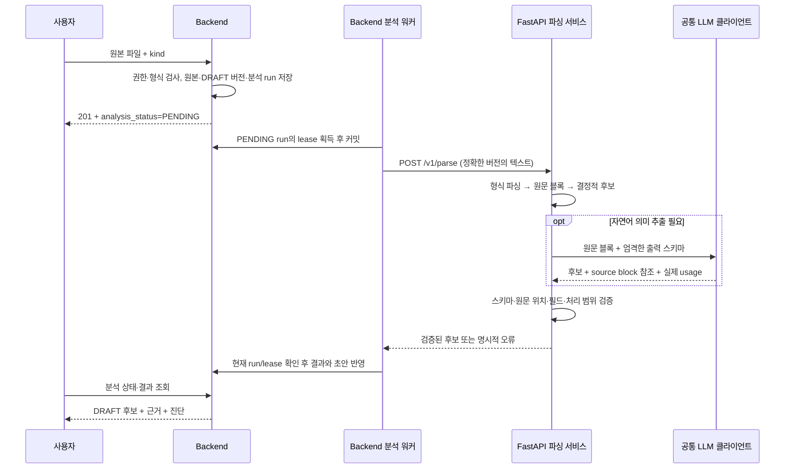

# #88 필수 문서 파싱·구조화 구현 설계안

작성: 2026-10-24 · 대상: S15P31A108-88 · 상태: 검토용 제안, 구현·팀 합의 전

사용자는 지원 형식이 아직 미정이며 현재 저장소와 일정에 맞춘 추천을 요청했다. 아래 형식·라이브러리·한도는 이 설계의 추천값이며 팀이 이미 확정한 사항이 아니다. 제품 코드, 기존 API 명세, DB 마이그레이션은 변경하지 않았다.

## 1. 목표와 경계

입력 파일을 **원본 버전과 위치를 다시 확인할 수 있는 설계 항목 후보**로 만든다. 성공은 JSON 생성 여부가 아니라 다음 네 조건으로 판단한다.

1. 지원하는 기획안·요구사항·API 명세·ERD 대표 입력을 처리한다.
2. 모든 후보가 실제 원문 블록과 정확한 문서 버전에 연결된다.
3. 지원하지 않는 구조·손상·모델 실패를 숨기지 않는다.
4. 재시도가 승인본이나 사람이 편집한 초안을 덮어쓰지 않는다.

#88은 파일 파싱·구조화 후보 추출까지 담당한다. 검색 청킹·임베딩·승인본 색인 갱신은 #89, 요청별 컨텍스트 조립은 #90, 문서 전체의 누락 분석·보완 질문 대화는 #91이다. #88의 questions는 추출 중 확인된 불명확한 필드에 관한 질문으로 제한한다. 문서에 없는 API나 FK를 설계해 주는 기능이 아니다.

박상은 담당 범위의 MVP 필수 동작은 원문 근거 검증, 처리 묶음 누락·중복 확인, 실패한 부분 결과의 미반영이다. 의미 검증 LLM의 전수 적용, 제목·표 헤더의 추가 문맥 보강, 최적 분할 크기·성능 목표는 평가 후 결정한다. 비교군·채점·측정 결과는 [문서 파싱 평가 계획](../../experiments/document-parsing-evaluation.md)에서 관리한다. #89의 승인본 검색 불변조건과 BE 협의 사항은 10절에서 구분한다.

### 현재 저장소에서 확인한 기반

- `ai/app/main.py`: root와 health만 구현. 내부 인증·파싱·공통 오류 처리도 구현해야 한다.
- `docs/api/03-ai-internal.md` AI-A01: `/v1/parse`는 JSON의 `content:string`을 받는 동기 API. AI는 후보만 반환하고 ID·상태·승인·DB 저장은 BE가 수행한다.
- `docs/api/01-backend-rest.md` DOC-A01/PLN-A01/PLN-A02: 업로드 후 분석 상태 조회·재시도 흐름이 이미 설계되어 있다.
- `docs/api/00-common.md` Q01/Q07: 항목별 content 스키마, 형식·용량·분석 실행·사람 편집 보존이 미결이다.
- `backend/src/main/resources/db/migration/V2__init_schema.sql`: document/version, design_item/version, source_locator JSONB가 있다. 분석 실행 테이블은 없다.
- `backend/src/main/resources/application.yml`: AI read timeout 기본값은 20초다. 문서 분석에 그대로 쓰기에는 예산 검증이 필요하다.

## 2. 접근법과 선택

| 대안 | 장점 | 이 프로젝트의 비용·한계 |
| --- | --- | --- |
| 전체 문서를 LLM에 전달 | 초기 데모가 단순함 | 원본 위치·누락·정확한 타입·FK를 검증하기 어렵고 구조화된 입력도 매번 모델 비용 발생 |
| 형식별 파서 + 선택적 LLM | 구조·위치는 코드로 추적, 자연어만 의미 추출 | 형식별 어댑터와 결과 검증을 작성해야 함 |
| PDF/OCR 중심 범용 문서 처리 | 다양한 파일을 바로 수용 | 표·스캔·좌표·모델 배포 검증까지 범위가 커짐 |

**두 번째를 추천한다.** 현재 실제 자료는 Markdown·SQL로 접근 가능하며, 구조가 있는 데이터를 모델에게 재작성시킬 이유가 적다. LLM이 필요한 것은 기획 문단과 자유 형식의 요구사항·API 설명이다.

## 3. 지원 형식: 문서 종류와 파일 형식을 분리

| kind | MVP 입력 | 처리 방식 |
| --- | --- | --- |
| PLAN | UTF-8 `.md` | 제목·문단·목록·표 추출 → 근거 블록을 붙여 LLM 의미 추출 |
| REQUIREMENTS | UTF-8 `.md` | 표와 요구사항 ID를 보존 → REQUIREMENT/POLICY/CONSTRAINT 후보 |
| API_SPEC | `.md`, OpenAPI 3.0.x/3.1.x 단일 `.json`/`.yaml`/`.yml` | Markdown은 제한적 LLM, OpenAPI는 operation 단위 결정적 추출 |
| ERD | PostgreSQL 스키마 DDL `.sql` | SQL AST → 테이블·컬럼·키·제약조건 |

Markdown 표는 GFM 계열의 pipe table만 지원한다. raw HTML 표·이미지 안의 표는 자동 추출 대상으로 인정하지 않고 진단을 반환한다. 일반 텍스트 파일은 Markdown으로 내보내도록 안내한다. 형식 검사는 확장자만 믿지 않고 실제 구문·인코딩·kind 조합을 함께 검사한다.

PDF, PNG/JPG ERD, DOCX, XLSX, HWP, Mermaid ER 문법 자체의 의미 해석은 이번 기본 범위에서 제외한다. 저장소의 ERD PNG는 시각적 참고 자료이며 DDL을 기계 입력으로 사용한다. 바이너리 입력 요구가 확정되면 bytes 전달·변환 프로필·페이지/셀 locator를 별도 확장해야 한다. 단순히 파일 확장자 허용 목록에 추가해서는 안 된다.

초기 리소스 한도 제안: 파일 1 MiB, 정규화 텍스트 100,000 Unicode 문자, LLM 대상 합계 32,000 모델 토큰, 후보 500개. 원문 AST 깊이·노드 수와 결과 크기도 제한한다. 이는 성능을 측정한 값이 아니며 대표 fixture로 조정할 출발점이다. 초과 입력을 조용히 자르지 않는다.

## 4. 전체 흐름과 소유권



**Backend / 오서현:** 파일 수신·권한·저장·원본 해시·document/version 발급, durable run, 상태·재시도, 최종 ID·초안 저장, 사람 편집·승인 보존.

**AI / 박상은:** 형식 어댑터, 원문 블록·locator, 의미 추출, content 스키마 검증, 후보·질문·진단·LLM 사용량 반환.

AI는 DB·파일 저장소에 직접 접근하지 않는다. 이번 텍스트 형식에서는 BE가 strict UTF-8 디코딩한 내용을 보낸다. OCR이나 파일 추출 책임은 이 설계로 암묵적으로 BE에 넘기지 않는다. 추후 바이너리 지원 시 별도 계약이 필요하다.

FastAPI 응답은 동기다. 사용자 요청을 오래 붙잡지 않는 것은 BE의 durable run과 상태 조회로 해결한다. FastAPI BackgroundTasks, Redis/Celery, LangGraph는 이 선형 흐름의 필수 구성요소가 아니다.

## 5. 파이프라인 상세

### 5.1 원본과 정규화 텍스트

- `content_hash`: 업로드한 **원본 bytes**의 SHA-256. 원본 storage_key·bytes·hash는 해당 document_version 동안 불변.
- `text_hash`: `content`를 UTF-8로 인코딩한 bytes의 SHA-256. AI가 직접 재계산해 검증.
- 정규화 규칙 `utf8-lf-v1`: strict UTF-8, 맨 앞 UTF-8 BOM 제거, CRLF/CR를 LF로 변환. trim·공백 합치기·Unicode NFKC는 하지 않는다.
- BOM·개행 변환으로 원본 해시와 텍스트 해시가 달라질 수 있다. 서로 같아야 한다는 검사 금지.
- source line은 정규화 텍스트 기준 **1-based, 끝 행 포함**. 원본도 같은 논리적 행으로 이동 가능하다. UTF-16 문자 offset을 Python 문자 offset으로 오인하지 않도록 외부 계약은 우선 행·JSON Pointer를 사용한다.
- `document_version_id`는 DB 버전이다. 문서 본문의 “v1.2”는 `declared_version` 같은 추출 메타일 뿐 DB 버전을 바꾸지 않는다.

### 5.2 공통 원문 블록

어댑터는 `SourceBlock[]`를 만든다. block_id, block_type, heading_path, locator, text_hash, 처리 결과를 갖는다. 모델 입력용 text는 메모리에서 원문 범위로 복원한다. 결과에는 원문 전체를 반복하지 않고 위치와 해시를 저장한다.

블록 유형: heading, paragraph, list_item, table 또는 table_row, code_block, api_operation, sql_statement. 블록 ID는 동일 텍스트 해시·프로필·locator에서 결정적으로 만든다. 파이프라인 버전이 바뀌면 ID 변경을 허용한다.

표는 헤더와 행·셀 배열을 보존한다. 긴 표는 행 묶음으로 나누며 원래 헤더와의 연결을 유지한다. 모델 입력에 헤더를 반복 첨부하는 문맥 보강은 평가 대상이다. 보강을 적용하면 원래 헤더의 block_id를 참조하고, 정규화한 표 내용을 원문 그대로인 것처럼 인용하지 않는다.

각 내용 블록의 처리 결과는 `EXTRACTED`, `NO_DESIGN_FACT`, `UNSUPPORTED`, `FAILED` 중 하나다. headings/설명 문장 등 설계 사실이 아닌 구간은 읽은 후 이유와 함께 NO_DESIGN_FACT가 될 수 있다. 내용을 담은 구간 하나라도 UNSUPPORTED/FAILED이면 전체 분석은 실패한다. 어느 구간이 필수인지 LLM이 임의로 정하게 하지 않는다. 프로필별로 빈 줄·구분선처럼 내용을 담지 않는 요소만 명시적 제외 목록으로 관리하며 제외 이유를 남긴다. 이미지 안의 내용이나 HTML 표를 이 목록으로 우회하지 않는다. 이 목록은 **처리 범위**를 보여 줄 뿐 의미적 재현율을 증명하지는 않는다.

### 5.3 형식별 처리

**Markdown — markdown-it-py**

블록 token의 map과 원문 행 인덱스로 위치를 만든다. 내부 text token에는 map이 없을 수 있으므로 모든 글자·셀의 정확한 offset을 보장하지 않는다. 최소 근거는 문단·표 행 또는 표 전체다. 제목 경로는 메타데이터로 보존하며 모델 입력에 추가 첨부할지는 평가 후 정한다. 코드 블록은 본문 명령으로 실행하지 않는다.

원문에 적힌 요구사항 ID는 `declared_key`로 보존한다. 중복 ID는 두 occurrence를 모두 남기고 경고한다. 최종 `REQ-001` 등의 키는 BE가 발급한다.

**OpenAPI — JSON/PyYAML + OpenAPI 검증**

JSON 중복 키를 거부한다. YAML은 안전한 node/compose 단계에서 중복 키·tag·alias·깊이·노드 수를 검사한다. 초기 프로필은 YAML alias/merge를 거부하고 JSON 호환 scalar만 허용한다. 각 operation을 API_CONTRACT로 만들고 method/path, parameters, requestBody, responses, security를 보존한다. path-level parameter와 operation override, 전역 security와 operation override를 구분한다.

JSON Pointer가 기본 locator다. YAML은 node mark로 행 범위도 제공한다. `$ref`는 같은 문서의 `#/...`만 허용하고 참조 사용 위치와 정의 위치를 둘 다 기록한다. 참조 그래프를 보존하며 무한히 inline하지 않는다. 정상적인 재귀 스키마는 순환 간선으로 남긴다. 존재하지 않는 내부 참조는 실패한다.

외부 파일·URL ref, 3.1 `$id`에 의한 scope 변경·`$dynamicRef`·anchor 참조 등 지원하지 않는 해석은 오류로 명시한다. callbacks/webhooks 등 초기 프로필 밖의 실행 계약도 조용히 버리지 않는다. “OpenAPI 3.x 전체 지원”이라고 표시하지 않는다. 3.0/3.1 schema 원문과 버전을 유지해 nullable, union, allOf/oneOf 등을 손실 변환하지 않는다. 서버 URL·권한·기본값 등 명세의 명시적 의미를 구현할 때 각 필드 출처와 해석 규칙을 남긴다.

**PostgreSQL DDL — pglast**

PostgreSQL 방언에 맞는 AST를 사용한다. 우선 CREATE TABLE의 컬럼·자료형·NULL·기본값·PK/FK/UNIQUE/CHECK 및 ALTER TABLE ADD CONSTRAINT를 지원한다. 복합키의 컬럼 순서, 참조 대상, ON DELETE/UPDATE, schema-qualified/quoted identifier를 보존한다. statement slice를 원문 행과 연결하고 테이블/제약 이름을 selector로 덧붙인다. AST를 재출력한 SQL을 원문으로 사용하지 않는다.

모든 CREATE TABLE을 먼저 수집한 뒤 ALTER 제약과 FK를 해석하여 선언 순서에 의존하지 않는다. FK는 명시된 제약만 추출한다. 파일 밖 테이블 참조는 `external_reference`로 남기며 그 구조를 추정하지 않는다. 요청 본문 SQL을 DB에서 실행하지 않는다. AST 파싱은 실제 DB에서 실행 가능한지에 대한 검증이 아니다.

입력은 **최종 구조를 표현하는 schema export**다. rename/drop/data migration/function/trigger/동적 SQL은 이번 프로필에서 지원하지 않는다. 전체 V2 migration을 무조건 성공시키지 않고 구조만 추린 fixture를 사용한다. 미지원 구조를 만나면 `unsupported_construct`와 해당 문장을 반환한다. 문법 버전은 PostgreSQL 17 자료로 검증한 pglast/libpg_query 조합을 고정하며 최신 패키지라는 이유만으로 호환을 가정하지 않는다.

### 5.4 LLM 추출 및 검증

모델에 문서 전체 대신 원문 블록 묶음을 보낸다. 제목 경로·표 헤더를 추가 제공할지는 실행 프로필에 명시한다. 원문은 비신뢰 데이터이며 도구 호출·네트워크·파일 실행 기능을 주지 않는다.

- Pydantic의 kind별 discriminated union과 `extra=forbid`, 엄격한 타입을 사용한다. JSON 형식 준수는 사실성 검증을 대신하지 않는다.
- 각 후보는 허용된 block_id와 원문 인용을 반환한다. 모델이 반환한 line/page/DB ID는 사용하지 않는다. locator는 파서가 붙인다.
- quote가 원문 블록에 실제 존재하는지, reference가 요청 범위 안인지 검사한다. 중요한 필드별 근거도 붙인다. 단순 substring 일치는 의미적 정확성의 증명이 아니므로 후보는 계속 DRAFT다.
- API method/path, 데이터 타입·FK처럼 정확성이 필요한 값은 가능한 한 형식 파서에서 가져온다. Markdown에 값이 없으면 해당 키를 null로 유지하고 `unresolved_fields`/질문으로 남기며 값을 만들지 않는다. DRAFT 추출 스키마와 승인 가능한 완전한 스키마를 구분한다.
- confidence 0.95 같은 모델의 자기 점수를 승인 기준으로 쓰지 않는다. 근거 해소·필수 필드·중복·진단 여부를 보여 준다.
- 구조화된 OpenAPI/DDL은 LLM 없이 성공할 수 있다. 원문에 없는 설명을 얻으려고 모델을 필수 호출하지 않는다.
- 토큰 분할은 제목·요구사항·표·operation 단위를 우선하며 블록과 참조를 유지한다. 긴 한 블록도 하위 원문 범위를 보존해 나눈다. 끝부분을 잘라내지 않는다.
- 초기값: 묶음당 입력 약 4,000 토큰, 최대 8묶음. 모델 출력 상한으로 인한 truncation은 성공이 아니다. 모든 묶음 결과를 검증한 뒤 문서 결과를 한 번에 반환한다.

#### 선택적 의미 검증

기계적 근거 검증은 MVP 필수다. 자연어 후보의 행위자·행동·대상·조건·예외·부정·수치가 원문과 일치하는지를 별도 LLM으로 검증하는 단계는 선택 사항이다. 전수 적용을 확정하지 않으며 평가 A에서 정상 정보 손실과 추가 비용을 함께 확인한 뒤 적용 범위를 결정한다.

| 판정 | 의미 | 적용 시 처리 |
| --- | --- | --- |
| SUPPORTED | 제시한 근거가 후보의 주장을 뒷받침함 | DRAFT 유지. 자동 승인 근거로 사용하지 않음 |
| CONTRADICTED | 후보가 근거와 모순됨 | 원래 후보·근거·판정 이유를 보존하고 수정·사용자 검토 대상으로 분류 |
| INSUFFICIENT | 제시한 근거만으로 후보를 뒷받침하기 부족함 | 값을 임의 보완하거나 조용히 삭제하지 않고 사용자 검토 대상으로 분류 |

의미 판정과 검증기 실행 상태를 분리한다. 미실행·timeout·잘못된 검증 출력은 INSUFFICIENT나 SUPPORTED로 변환하지 않는다. 내부 실행 기록에 NOT_RUN/COMPLETED/ERROR를 구분하고, 실행 실패 후보는 미검증 검토 대상으로 남긴다. 선택적 검증기 오류가 정상 추출 결과를 삭제하지 않으며 검증을 통과한 것으로 표시하지도 않는다. 필수 추출·근거 검증 실패의 문서 단위 미반영 규칙은 그대로 적용한다.

적용 시 후보 식별자·근거·판정 이유·검증 모델/프롬프트 버전·실제 사용량을 기록한다. 이 상태는 우선 내부 진단·평가 개념이며 신규 공통 API 필드나 승인 정책으로 자동 확정하지 않는다. 외부 전달이 필요하면 BE와 계약을 합의한 후 API 명세에 반영한다.

#### 분할·문맥·병합

- 제목·요구사항·표 행·API operation의 구조 경계를 우선한다. 한 단위가 한도를 초과하면 하위 원문 범위를 추적하며 분할한다. 추가 문맥도 토큰 한도에 포함한다.
- 각 처리 묶음의 work_unit_id, 원본 block_id/범위, 추가 문맥 참조, 실행 시도와 결과를 기록한다. 원문 처리 대상과 보조 문맥을 구분하여, 반복 제공한 제목·헤더를 새 요구사항으로 세지 않는다.
- 요청한 묶음과 반환된 묶음을 대조하고 원문 처리 범위·스키마·근거를 모두 검증한 뒤 병합한다. 누락 묶음, 출력 잘림, 해결되지 않은 필수 실패가 있으면 문서 전체 후보를 반영하지 않는다. 임시 결과를 DRAFT나 검색 자료로 노출하지 않는다.
- 동일 묶음의 재전송·재시도 결과를 두 번 합치지 않는다. 겹치는 분할 경계의 후보는 같은 문서 버전·항목 종류·원문 근거 범위·내용이 일치하는 경우에만 중복 병합한다. 근거 참조는 보존한다. 문장이 비슷해도 역할·조건·근거가 다르면 유지하고, 동일 declared_key의 충돌도 덮어쓰지 않는다.
- 모든 묶음의 처리 완료는 의미적 누락이 없다는 보장이 아니다. 명시된 요구사항 ID 대조와 사람이 작성한 정답 평가를 별도로 수행한다.

이 절의 분할은 #88 LLM 입력 처리 단위다. #89의 검색 청크 최적화와 동일한 정책으로 고정하지 않는다.

## 6. 항목 본문 스키마 제안 — Q01 합의 대상

| kind | 최소 데이터 | 금지할 추정 |
| --- | --- | --- |
| REQUIREMENT | statement, declared_key?, actor?, conditions[], acceptance_criteria[] | 없는 수락 조건을 채워 넣기 |
| API_CONTRACT | method, path, spec_version?, parameters, request_body?, responses, security | 없는 method/path/status code 발명 |
| DATA_CONTRACT | schema_name?, table_name, columns[], constraints[], external_references[] | `*_id` 이름만 보고 FK 만들기 |
| POLICY | statement, scope?, exceptions[] | 팀 결정 전 내용을 확정 정책으로 표시 |
| CONSTRAINT | statement, category?, value?, unit? | 정성 조건을 임의 수치로 바꾸기 |

원문에 없는 선택 필드는 null/빈 배열과 unresolved_fields로 구분한다. `[]`가 “없음이 명시됨”인지 “미정”인지 중요하면 필드별 presence(`EXPLICIT`, `UNSPECIFIED`)를 저장한다. 콘텐츠마다 허용 키·자료형을 고정하며 임의 object를 영구 계약으로 두지 않는다. 위 목록은 개념 스키마이며 실제 JSON Schema/fixture를 BE와 함께 고정한다.

API_CONTRACT DRAFT는 `method`와 `path` 키 자체는 필수지만 값을 `string|null`로 허용한다. null이면 항목 최상위 `unresolved_fields`에 `/method`, `/path`처럼 content 내부 JSON Pointer를 반드시 기록한다. 예를 들어 “프로젝트 조회 API가 필요하다”는 원문은 method/path를 발명하지 않은 불완전 초안으로 남길 수 있다. 반면 OpenAPI operation에서 나온 두 값은 반드시 존재해야 한다. BE의 승인용 검증은 method/path의 null·잘못된 형태를 거부하며, 미완성 API_CONTRACT는 승인·baseline 반영 대상이 아니다. 이는 추출 실패와 별개의 검토 상태다. 승인용 검증 추가는 오서현과 합의할 연동 조건이다.

분할 단위는 요구사항 1개, API operation 1개, DB 테이블 1개를 기본으로 한다. 정책·제약은 독립적으로 참조할 수 있는 사실 단위로 분리한다. 같은 사실을 여러 위치가 설명하면 여러 source_refs를 보존한다. 다른 문서 간 동일 항목 매칭·자동 병합은 #88에서 하지 않는다.

## 7. `/v1/parse` 계약 조정안

기존 필드를 유지하면서 **parse_contract_version=1의 새 합의 스키마**로 양쪽 구현을 맞춘다. 아직 업무 구현 전이므로 암묵적 호환보다 명시적 계약 변경을 택한다.

Request 기존 필드: project_id, request_key, document_version_id, kind, media_type, content, content_hash.
추가 필드: parse_contract_version, text_hash, normalization_version, parser_profile, expected_pipeline_version. parser_profile은 `markdown-v1`, `openapi-v1`, `postgres-schema-v1` 같은 서버 allowlist다. BE는 배포 설정에서 선택한 pipeline manifest 버전으로 run의 input_hash를 만들고, AI는 요청 버전과 자신이 실행할 버전이 다르면 호출 전 409 pipeline_version_mismatch로 거부한다. AI는 실제 pipeline_version도 응답한다. 파일명으로 파서를 추측하지 않는다.

응답 예시(해시는 설명용):

```json
{
  "result": {
    "parse_contract_version": 1,
    "document_version_id": "211",
    "content_hash": "sha256:raw-file-hash",
    "text_hash": "sha256:normalized-text-hash",
    "pipeline_version": "parse-2026-10-v1",
    "source_blocks": [{
      "block_id": "b-17",
      "block_type": "paragraph",
      "locator": {"type": "text_lines", "start_line": 12, "end_line": 13},
      "text_hash": "sha256:block-hash"
    }],
    "items": [{
      "candidate_key": "c-1",
      "kind": "REQUIREMENT",
      "title": "프로젝트 목록 조회",
      "schema_version": 1,
      "content": {"statement": "로그인한 사용자는 프로젝트 목록을 조회한다.", "declared_key": "REQ-01", "actor": "로그인한 사용자", "conditions": [], "acceptance_criteria": []},
      "location": "계정 / REQ-01 / 12–13행",
      "source_refs": [{"block_id": "b-17", "quote": "로그인한 사용자는 프로젝트 목록을 조회한다."}],
      "extraction_method": "MODEL",
      "unresolved_fields": []
    }],
    "questions": [],
    "missing_candidates": [],
    "diagnostics": [],
    "block_outcomes": [{"block_id": "b-17", "status": "EXTRACTED", "candidate_keys": ["c-1"]}]
  },
  "origin": "MODEL",
  "model": "configured-model",
  "usage": [{"request_key": "run-51-window-1-call-1", "feature": "DOCUMENT_PARSE", "model": "configured-model", "input_tokens": 400, "output_tokens": 160, "latency_ms": 1800, "failed": false, "tokens_known": true}]
}
```

`candidate_key`는 응답 안의 임시 키이며 문서나 버전을 가로지르는 동일성을 보장하지 않는다. BE는 `(analysis_run_id,candidate_key)`로 중복을 막는다. LLM 출력의 완전한 재현성을 약속하지 않고 저장된 run 결과를 재사용한다.

상위 `origin`은 모델을 한 번이라도 호출했으면 MODEL, 전혀 호출하지 않았으면 **PARSER**로 제안한다. 혼합 실행은 항목별 extraction_method로 구분한다. PARSER 성공에는 model을 생략하고 usage=[]로 둔다. TEMPLATE를 결정적 파서의 출처처럼 사용하지 않는다. 현재 명세의 MODEL-only 규칙 변경이므로 오서현·공통 LLM 담당자와 합의해야 한다.

BE는 locator와 quote를 재검증하고 authoritative document_id/version_no를 결합한다. UI 표시용 `location`은 유지하되 실제 근거 이동에는 typed locator를 사용한다. 기존 DB `source_locator JSONB`에는 문서 버전 + 복수 locator/quote를 보존할 수 있도록 버전 있는 구조를 저장한다. `title`은 DB 필수값이므로 응답에도 추가한다.

## 8. 실행·재시도·DB 저장

### 필요한 스키마 변경 제안

V2를 수정하지 않고 새 Flyway migration으로 추가한다.

1. document_version: 원본 `file_name/media_type/size_bytes`, 정규화 `text_hash/normalization_version`, `latest_analysis_run_id`. 원문 본문·해시의 불변성도 보장한다. 추출 버전별 산출물은 run에 저장한다.
2. document_analysis_run: `id/document_version_id/attempt/request_key/status/input_hash/pipeline_version/lease_token/lease_until/result_json/error_code/applied_at/created_at/started_at/finished_at`. `UNIQUE(request_key)`, `UNIQUE(document_version_id,attempt)`, 동일 버전 활성 run 1개 제약.
3. design_item_version에 `analysis_run_id/candidate_key`로 후보 추적을 추가할 수 있다. 자동 생성 후보에 `UNIQUE(analysis_run_id,candidate_key)`를 적용한다. 사람 편집은 기존 항목을 바꾸더라도 후보 결과 자체를 바꾸지 않는다.
4. 결정적 추출은 기존 AI_EXTRACTED와 구별하는 SYSTEM_EXTRACTED origin을 추가하거나 동등한 추출 메타를 명시적으로 저장한다. CHECK 제약 변경도 포함한다.

API의 REQUIREMENTS ↔ DB의 REQ_SPEC은 BE mapper에서 명시적으로 변환한다. `parse_status` 기존 PENDING/OK/FAILED는 호환 요약값으로 유지 가능하다. 외부 PENDING/RUNNING/COMPLETED/FAILED는 run에서 조회한다. COMPLETED는 파싱 성공이고 승인 완료가 아니다.

### 트랜잭션과 복구

- 업로드 시 원본 파일은 임시 저장 후 원자적 이동으로 확정한다. DB 실패로 남은 파일은 고아 파일 정리 대상으로 기록한다. 파일시스템과 DB가 하나의 원자적 트랜잭션이라고 가정하지 않는다.
- 원본 버전과 PENDING run을 같은 DB 트랜잭션으로 만든다. ID 발급·idempotency 처리도 BE 책임이다.
- 워커는 run을 잠가 RUNNING/lease를 기록하고 **커밋한 뒤** AI를 호출한다. 모델 응답을 기다리면서 DB 잠금을 유지하지 않는다.
- 완료 시 run 상태·lease_token·latest_analysis_run_id·input_hash를 대조한다. 모두 일치한 경우만 결과 저장·최초 초안 생성·applied_at·COMPLETED를 한 트랜잭션으로 처리한다. 초안 자동 반영은 해당 원본이 여전히 적용 대상 DRAFT일 때만 가능하다. 업로드·승인과 경합하여 적용 대상이 바뀌었다면 검증된 결과는 원래 버전의 실행 이력으로 보존하고 자동 반영하지 않으며 이유를 기록한다. 새 버전이나 승인본으로 결과를 옮겨 붙이지 않는다.
- lease가 만료되면 기존 run을 실패로 닫고 새 attempt를 생성한다. 예전 결과는 늦게 도착해도 새 run이나 초안을 덮어쓰지 않는다.
- 자동 재시도·사용자 재시도는 같은 문서 버전의 새로운 run이다. **원본 변경만 새 document_version**이다.
- 첫 성공은 초안을 한 번 생성할 수 있다. 이미 적용된 성공 결과가 있다면 재분석은 별도 후보 세트로만 보존하고 기존 사람 편집 초안에는 자동 반영하지 않는다. 재분석 비교·선택 반영 UI는 확장 범위이며 최소 MVP에서는 성공한 run의 재분석을 막고 실패 재시도만 노출해도 된다.
- API 상태 조회는 latest run 상태와 이미 보존된 DRAFT를 구분한다. 실패 응답을 “초안이 사라짐”으로 해석하지 않도록 기존 초안 참조를 유지한다.

재사용 키는 project/document_version, content/text hash, kind/profile, contract/normalization/parser/prompt/schema/model 설정을 포함한 input fingerprint다. 원본 hash만 같다고 다른 프로젝트 결과를 공유하지 않는다. 각 실행은 실제 pipeline manifest를 기록한다.

BE 업로드 Idempotency-Key, 분석 run request_key, 실제 LLM 호출 usage key는 서로 다른 목적이다. AI HTTP timeout은 모델 호출이 없었다는 뜻이 아니다. 저장 중복은 막을 수 있지만 네트워크 단절 뒤 재실행은 LLM 비용이 다시 들 수 있다. MVP에서 정확히 한 번의 모델 실행을 보장한다고 표현하지 않는다. AI가 응답하지 못한 호출은 사용량 미확인으로 기록한다.

## 9. 실패·시간 예산

| 상황 | 제안 처리 | 자동 재시도 |
| --- | --- | --- |
| 미지원 형식/kind 조합 | 415 unsupported_media_type | 없음 |
| 바이트·문자·토큰 한도 초과 | 413 document_limit_exceeded | 없음 |
| 인코딩/문법 손상 | 422 invalid_document_syntax | 없음 |
| 미지원 DDL/OpenAPI 구조·외부 ref | 422 unsupported_construct/reference | 없음 |
| 빈 파일/내용 없음 | 422 no_extractable_content | 없음 |
| 정상 처리했으나 설계 항목 0개 | 200 + items=[] + no_design_items 진단, 처리 범위 증거 | 자동 재시도 없음 |
| 입력 text hash 불일치 | 422 source_hash_mismatch | 전송/정규화 오류 해결 후 |
| 요청·실제 pipeline 버전 불일치 | 409 pipeline_version_mismatch | 배포 설정 일치 후 새 run |
| 필수 추출 모델 출력 스키마·근거 위반 | 502 invalid_model_output | 남은 예산에서 교정 1회 |
| 필수 추출 모델의 일시적 공급자 실패·rate limit | 502 model_unavailable | BE에서 backoff, 최대 2 attempts 제안 |
| 전체 분석 예산 초과 | 504 parse_timeout | 제한된 새 attempt |

외부 사용자에게는 공통 오류 규약을, 내부에는 실패한 블록·원인·발생한 usage를 전달한다. 손상 문서를 빈 items로 성공시키거나 정상 후보 일부만 저장하는 PARTIAL 상태는 이번 계약에 추가하지 않는다. 실패 진단은 남기되 후보 적용은 문서 단위로 한다. 파싱 자체가 성공해도 미정 필드가 있을 수 있으며, 경고와 승인 검토로 처리한다.

선택적 의미 검증기의 오류는 5.4절의 미검증 진단으로 처리한다. 원문 파싱·필수 추출 실패와 구분하며, 실제 호출 비용은 어느 경로에서든 기록한다.

기존 PLN-A01의 “실패 상태와 결과 0건을 구분” 규칙을 유지한다. 전 구간을 정상 처리했고 설계 사실이 없는 문서는 진단을 포함한 0건 성공이 가능하다. 모델 장애·미지원 구간을 0건으로 위장하는 것은 금지한다. 후보 0건 문서로 필수 설계 준비를 충족했는지는 별도 BE 승인 요건이며 파서가 승인 판정을 하지 않는다.

초기 예산 제안: LLM 단일 호출 25초, AI 전체 90초, BE parse 전용 read timeout 100초, lease 120초. 공급자 제한과 실제 입력으로 조정할 값이며 SLA가 아니다. 교정·재시도도 90초 안에 포함한다. 기존 공통 20초 타임아웃을 모든 AI 기능에 일괄 확대하지 않고 parse 전용 설정을 둔다. 프로세스 단위 동시 분석·LLM 호출 수를 제한하고 과부하는 BE 큐에 남긴다.

## 10. #89와의 연결

#88의 원문 구조 블록은 **증거 단위**이고 #89의 검색 chunk는 **검색 단위**다. 서로 같다고 고정하지 않는다. #89는 성공 run의 정규화 텍스트·블록·locator·버전·추출 프로필을 입력받는다. 검색 청크의 크기와 제목·표 헤더 보강 정책은 별도로 평가한다.

파싱 성공을 임베딩 준비 완료와 분리한다. 임베딩 장애가 파싱 결과를 FAILED로 되돌리지 않는다. 현재 `document_chunk`의 vector(1024)는 별도 모델 결정 사항이다. #88에서 임베딩 차원을 고정하지 않는다.

현재 승인본 검색은 `project.current_baseline_id → baseline_document/baseline_item`에서 허용된 정확한 버전만 사용한다. 파싱이 완료된 DRAFT를 승인 검색 결과에 노출하지 않는다.

박상은의 #89 검색·AI 연동에서는 선택된 승인 baseline에 속한 근거만 모델 입력에 전달하고, 사용한 문서 버전과 locator를 추적할 수 있어야 한다. 미승인 문서나 이전 정책을 현재 승인 설계로 표시하지 않는 것은 필수 불변조건이다.

다음은 BE·검색·에이전트 응답 담당자와 합의할 계약 후보이며 #88의 추가 구현 범위가 아니다.

- 응답 보장 기준 제안: **서버의 최종 검증 시점에 확인한 승인 baseline과 응답 근거가 일치한다.** 검사 직후 새 승인이 가능하므로 사용자 수신 시점까지의 최신성을 보장한다고 표현하지 않는다.
- 검색·생성 중 baseline 변경 시 재검색·재생성할지, 제한된 재시도 안내를 반환할지 정한다.
- 새 승인본의 임베딩 미준비 시 준비 중 응답 또는 현재 승인 원문을 사용하는 대체 경로를 정한다. 이전 버전을 현재 정책처럼 반환하는 fallback은 허용하지 않는다.
- `baseline_id`, `validated_at`, 사용 문서 버전의 외부 응답 포함 여부와 권위 있는 검증 지점을 합의한다. 시각만으로 버전 일치를 판정하지 않는다.

색인 세대 전환·승인과 응답 발행의 동시성 제어는 공동 설계 후 범위를 정한다. 평가 C에서 검색 결과·모델 입력·최종 응답을 확인하되, BE 연동 전 모의 실험을 실제 서비스의 동시성 보장으로 보고하지 않는다. 이 문서의 협의 항목만으로 공통 API를 변경하지 않는다.

## 11. 코드 구성 제안

```text
ai/app/
  routers/parse.py                 # 내부 인증·입출력·오류 매핑
  schemas/parse.py                 # request/result/source/diagnostics
  schemas/design_items.py          # kind별 content schema
  services/document_parsing/
    pipeline.py                   # 전체 시간·한도·흐름
    adapters/markdown.py           # 블록·표·행 위치
    adapters/openapi.py            # 구문·참조·operation
    adapters/postgres_ddl.py       # statement·AST·제약조건
    extraction.py                 # 공통 LLM 클라이언트 호출
    evidence.py                   # quote/locator/필드 근거 검증
    normalization.py              # 해시·정규화·행 인덱스
ai/tests/
  fixtures/parsing/                # 원문 + 기대 구조 + 기대 위치
  test_parse_adapters.py
  test_parse_contract.py
  test_parse_evidence.py
  test_parse_failures.py
```

라이브러리 후보는 markdown-it-py, PyYAML, pglast, OpenAPI schema validator, 기존 Pydantic/HTTPX/공통 LLM 클라이언트다. 설치 전에 Python·CI·Linux 배포 호환과 라이선스를 확인하고 검증된 버전으로 고정한다. 특히 pglast는 native dependency이므로 Windows 개발·Linux 배포 둘 다 wheel/빌드를 확인한다. JSON Schema를 반환하는 모델 기능은 공통 LLM 계층으로 통합하며 #88에 별도 공급자 SDK 경로를 복제하지 않는다.

## 12. 검증과 인수 기준

### 자동 테스트

| 분류 | 의미 있는 검증 |
| --- | --- |
| 대표 4종 | 기획 Markdown, 요구사항 표 Markdown, API Markdown/OpenAPI, PostgreSQL DDL의 기대 항목·종류·근거 비교 |
| 손상·미지원 | 깨진 JSON/YAML/SQL, invalid UTF-8, 빈 문서, 위장 확장자, HTML 표/ERD 이미지, 외부 ref, 미지원 DDL. 정상 요구사항과 미지원 HTML 표가 섞인 파일도 전체 실패 |
| 근거 | 한글·emoji·CRLF·BOM, 중복 문장·동일 제목, 긴 표, SQL quoted name·복합 FK·ALTER 제약, JSON Pointer escape |
| 모델 | 존재하지 않는 block_id, 없는 인용, 발명된 API/필드, 잘린 JSON, 일부 묶음 실패, 사용량 포함 오류 |
| 선택적 의미 검증 | SUPPORTED/CONTRADICTED/INSUFFICIENT 처리, 정상 후보 오판의 검토 가능성, NOT_RUN/ERROR를 의미 판정과 혼동하지 않음, 자동 승인 없음 |
| 분할·병합 | 묶음 누락·중복 응답, 경계 중복 후보, 반복 헤더와 새 항목의 구분, 같은 문장·다른 조건의 보존, 실패 부분 결과 미반영 |
| 실행 | 중복 접수, 같은 버전 동시 재시도, worker crash, lease 만료 뒤 늦은 결과, 저장 rollback, 사람 수정 초안 보존 |
| 경계 | 실패 시 승인본·baseline 불변, DRAFT가 승인 검색에 미노출, API REQUIREMENTS/DB REQ_SPEC 매핑. Markdown의 누락 method/path는 null+unresolved_fields로 저장되고 승인 검증에서는 거부 |

단위·계약 테스트는 고정 응답의 fake LLM으로 반복 가능하게 한다. 별도로 실제 모델 평가 세트를 돌려 프롬프트의 품질을 측정한다. 둘을 대체 관계로 보지 않는다.

### MVP 인수 기준과 별도 평가

- 대표 4종 fixture와 실패 fixture에서 locator 해소율 100%, 출처 없는 반영 후보 0건을 필수 통과 조건으로 둔다. 구조화 OpenAPI/DDL은 지원 범위의 operation·컬럼·키를 정확히 일치 비교한다.
- 요청한 처리 묶음의 누락·중복 반영이 없고 모든 후보가 원문 범위로 추적된다. 필수 묶음 실패·출력 잘림·근거 오류 시 부분 결과를 반영하지 않는다.
- 선택적 의미 검증을 적용하면 세 판정과 미실행·오류를 구분하며, 모순·불충분 후보의 원본·이유를 검토할 수 있다. 의미 검증 자체로 승인하지 않는다.
- 자연어 추출의 오류 통과·정상 정보 오차단·재현율, 분할 후 중복률·실제 토큰·지연을 측정한다. 처리 범위 검사만으로 의미적 재현율을 주장하지 않는다.
- 비교군·정답 데이터·반복·채점·결과는 [별도 평가 문서](../../experiments/document-parsing-evaluation.md)에 둔다. 정확도·지연·비용의 수치 목표와 의미 검증 적용 범위는 평가 후 확정한다. 실험 전 수치를 달성 결과나 MVP 합격선으로 사용하지 않는다.

## 13. 구현 순서와 담당자 간 합의

1. **계약·fixture 고정:** 지원 형식, Q01 content schema, typed locator, 해시, origin=PARSER, 실패 규칙을 오서현과 맞춘다. 공통 LLM 호출·사용량 인터페이스를 담당자와 확인한다.
2. **세로 경로 하나:** 요구사항 Markdown → 원문 블록 → fake LLM → 검증된 후보 → BE run → DRAFT/근거 조회. 이 단계에서 재시도·원본 버전 연결을 먼저 검증한다.
3. **결정적 어댑터:** PostgreSQL schema DDL, OpenAPI JSON/YAML. API Markdown은 첫 경로의 자연어 추출을 확장한다.
4. **실제 모델:** 기획/요구사항/API Markdown의 의미 추출·토큰 분할·usage 기록·출처 검증.
5. **실패·경합 검증:** timeout, 중복·늦은 결과, 사람 편집 보존, 대표 4종/손상 파일, 품질 보고.

BE의 run/업로드 구현을 #88 AI 작업 안에 숨겨 잡지 않는다. 오서현과 계약 fixture를 먼저 공유하고 AI는 stub BE 입력으로 개발할 수 있다. #89는 같은 블록/locator fixture로 병행 착수 가능하다. 8점은 상대 추정치이므로 여기서 일수로 환산하지 않는다. 지원 형식·백엔드 실행 기반까지 포함하면 범위가 커지므로 Jira 하위 체크리스트와 별도 BE 연동 작업으로 분리한다.

## 14. 참고 자료

- [Jira #88](https://ssafy.atlassian.net/browse/S15P31A108-88)
- [내부 API 초안](../../api/03-ai-internal.md), [공통 계약](../../api/00-common.md), [Backend REST](../../api/01-backend-rest.md)
- [markdown-it-py Token.map](https://markdown-it-py.readthedocs.io/en/latest/api/markdown_it.token.html), [파서 설정](https://markdown-it-py.readthedocs.io/en/latest/using.html)
- [OpenAPI 3.1 명세](https://spec.openapis.org/oas/v3.1.html), [PyYAML node/mark 문서](https://pyyaml.org/wiki/PyYAMLDocumentation)
- [pglast parser·statement slice·UTF-8 위치](https://pglast.readthedocs.io/en/latest/parser.html)
- [Pydantic 모델 검증](https://docs.pydantic.dev/latest/concepts/models/)
- [FastAPI BackgroundTasks의 적용 범위](https://fastapi.tiangolo.com/tutorial/background-tasks/)

공식 문서의 기능을 확인해 라이브러리 후보를 골랐지만 이 저장소에서 패키지 설치·실행 벤치마크를 수행한 것은 아니다. 이 문서는 설계 제안이며 구현 완료 보고가 아니다.
